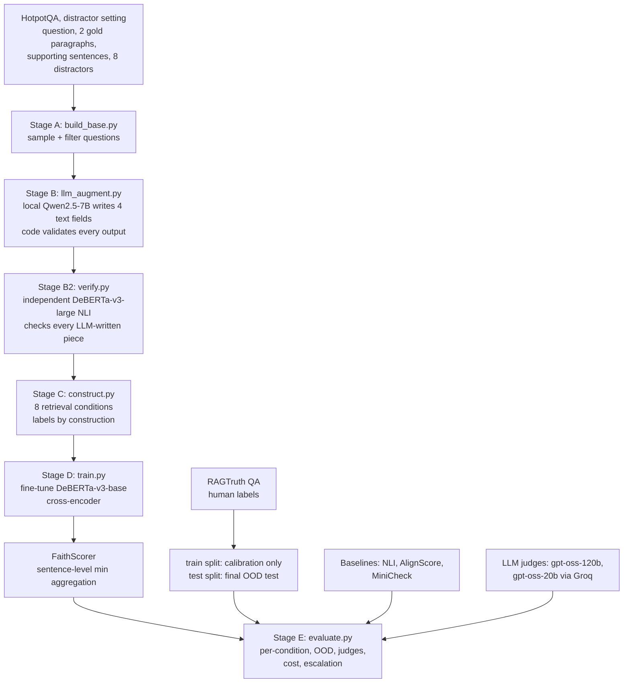
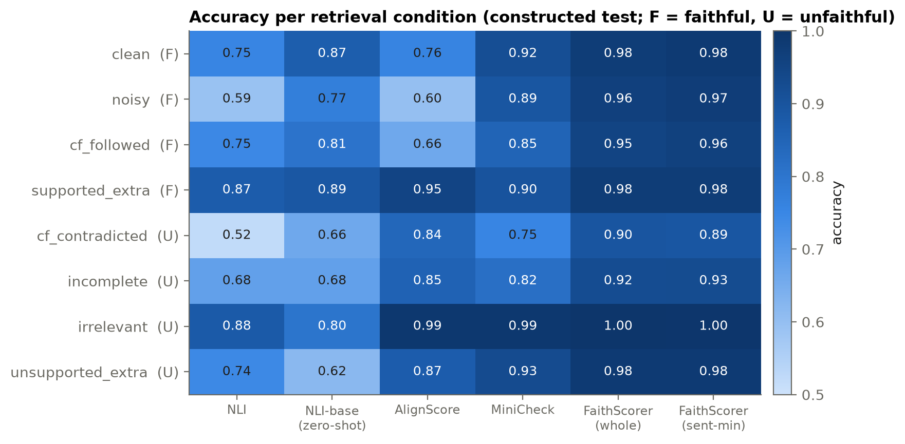
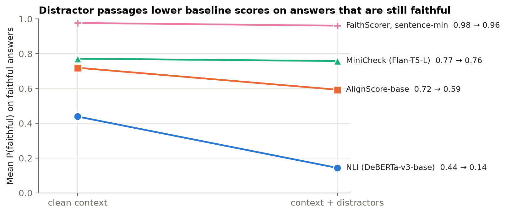
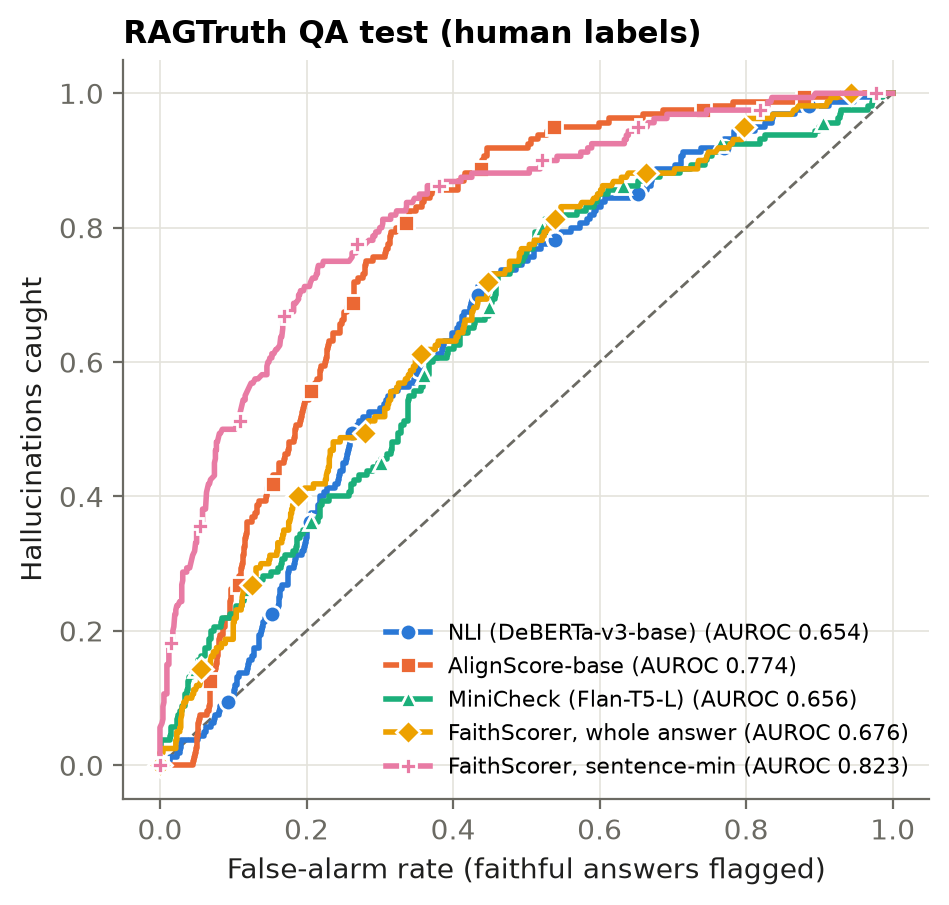
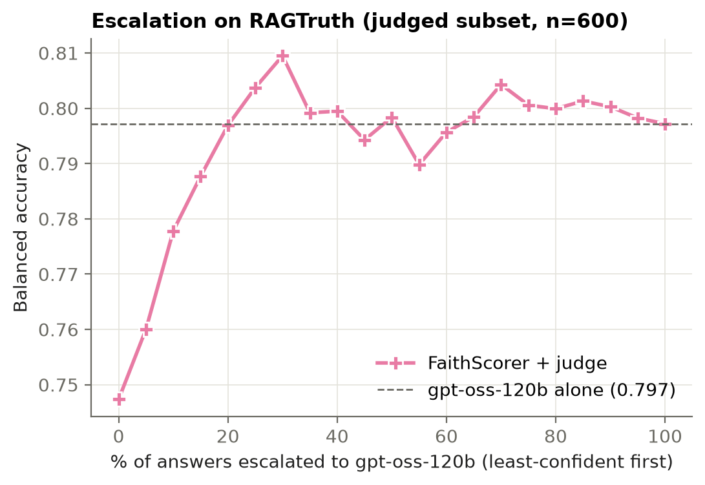
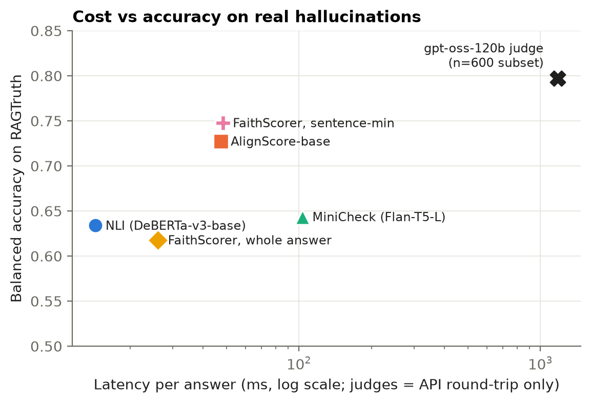

# FaithScorer

**A 184M-parameter faithfulness scorer for Retrieval-Augmented Generation (RAG) that stays reliable when retrieval goes wrong, trained entirely on data whose labels are known by construction.**

FaithScorer reads a retrieved context and a generated answer and returns P(faithful): the probability that every claim in the answer is supported by that context. It runs locally in 25–50 ms per answer on a laptop GPU. It is the most accurate of the lightweight scorers we tested, both on our noise-stratified benchmark and on RAGTruth, an independent benchmark of real LLM answers with human hallucination labels. Paired with an LLM judge that only sees the least-confident 20% of answers, it matches the judge's accuracy at a fifth of the judge calls.

> Final-year B.Tech project, Department of Computer Science and Engineering, Amrita School of Computing, Chennai (October 2026).
> Tarun Ramkumar Gargeya and T S Akarsh Velan; supervisor Dr K. Deepak.
> The full project report, with every design decision, is in [`docs/REPORT.md`](docs/REPORT.md).

---

## Contents

1. [At a glance](#1-at-a-glance)
2. [The problem](#2-the-problem)
3. [Faithfulness is not correctness](#3-faithfulness-is-not-correctness)
4. [How FaithScorer works](#4-how-faithscorer-works)
5. [Datasets](#5-datasets)
6. [Evaluation protocol](#6-evaluation-protocol)
7. [Results](#7-results)
8. [Why it does better than existing scorers](#8-why-it-does-better-than-existing-scorers)
9. [Limitations and caveats](#9-limitations-and-caveats)
10. [Live demo](#10-live-demo)
11. [Reproducing everything](#11-reproducing-everything)
12. [Repository layout](#12-repository-layout)
13. [Licences and data attribution](#13-licences-and-data-attribution)
14. [Related work](#14-related-work)
15. [How this project got here](#15-how-this-project-got-here)

---

## 1. At a glance

| | FaithScorer (sentence-min) | Best lightweight baseline | LLM judge |
|---|---|---|---|
| Constructed test set, 8 retrieval conditions (balanced accuracy) | **0.961** | 0.881 (MiniCheck) | 0.880 (gpt-oss-20b, 200-example sample) |
| RAGTruth, real hallucinations, human labels (AUROC) | **0.823** | 0.774 (AlignScore) | — (gives labels, not scores) |
| RAGTruth balanced accuracy, threshold calibrated on RAGTruth's train split | 0.748 | 0.727 (AlignScore) | **0.797** (gpt-oss-120b, 600 examples) |
| FaithScorer + judge on the least-confident 20% | **0.797**, equal to the judge alone | | |
| Latency per answer | 25–48 ms, local | 47–269 ms (AlignScore) | ~1.2 s API + daily quota |
| Parameters | 184M | 125M (AlignScore-base) | 117B total / 5.1B active (gpt-oss-120b) |

What is new here:

- **Labels by construction.** Training data is built so that every label follows from *how* the example was made, not from an LLM's or annotator's opinion. A local 7B LLM writes text, code validates it, an independent NLI model verifies it, and a deterministic program assembles (context, answer) pairs whose faithfulness is known.
- **Eight controlled retrieval conditions**, including *minimal pairs* that differ in exactly one respect, and **faithful-but-false** examples that force the model to judge support, not truth.
- **Evaluator robustness, not generator robustness.** Prior work on noisy retrieval mostly asks whether the *generator* survives bad passages. We ask whether the *checker* does, and show that common lightweight checkers do not.
- **An honest out-of-distribution test.** The headline comparison is on RAGTruth: answers from six other LLMs, labelled by humans, never used for training. The aggregation method and the thresholds were chosen on RAGTruth's separate training split before its test split was scored.

---

## 2. The problem

RAG systems retrieve passages and ask an LLM to answer from them. The LLM can still:

- **add unsupported information:** details that appear nowhere in the passages;
- **contradict the context:** state something the passages say is otherwise;
- **ground only part of the answer:** some claims are supported, others are not;
- **ignore the context and answer from memory**, especially when the retrieved passages are irrelevant or incomplete.

Detecting this reliably today means asking a strong LLM to judge every answer (LLM-as-judge). That is accurate but slow (about a second per call), costs money, and is rate-limited: on the free tier used in this project, gpt-oss-120b allowed about 285 judgments per day.

Lightweight scorers exist (NLI cross-encoders, AlignScore, MiniCheck). They are fast, but they were developed and reported on benchmarks that do not vary retrieval quality. Retrieval in practice is noisy: retrievers return related-but-irrelevant passages, incomplete passages, and passages that conflict with each other. We measured what this does to the checkers. Adding distractor passages around **unchanged** evidence lowered AlignScore's mean score on faithful answers from 0.72 to 0.59, and an NLI cross-encoder's from 0.44 to 0.14. In a deployed system, that means false alarms on correct answers whenever retrieval returns extra passages.

**Goal:** a cheap scorer that stays reliable under degraded retrieval, measured against both lightweight baselines and LLM judges, on real human-labelled hallucinations.

---

## 3. Faithfulness is not correctness

| | The context says… | The answer says… | Faithful? | Correct? |
|---|---|---|---|---|
| Faithful and correct | Paris is the capital of France | Paris | ✔ | ✔ |
| **Faithful but wrong** | (a corrupted document) Lyon is the capital of France | Lyon | ✔ | ✘ |
| **Unfaithful but right** | (irrelevant passages about French cuisine) | Paris | ✘ | ✔ |

A RAG guardrail must measure **faithfulness**. It is the property a RAG system promises (answers come from the sources), and it is the only one that can be checked without already knowing the truth. Many checkers, and many LLM judges, partly reward answers that *sound true*. FaithScorer is trained on examples where the faithful answer is factually false and the unfaithful answer is factually true, so it cannot rely on plausibility.

---

## 4. How FaithScorer works

### 4.1 Pipeline



The key design choice: **LLMs write text, never labels.** A label is decided by which context is paired with which answer, and that pairing is made by a deterministic program.

### 4.2 Stage A: questions with known evidence (`src/data/build_base.py`)

HotpotQA's *distractor* setting gives, for each multi-hop question, the two gold Wikipedia paragraphs, the exact supporting sentences, and eight distractor paragraphs retrieved by bigram TF-IDF similarity to the question. Those distractors are natural *related-but-irrelevant* hard negatives.

Filters (so that later edits are guaranteed to change what the context supports):

- skip yes/no questions;
- exactly two gold paragraphs;
- the gold answer appears verbatim in **exactly one** supporting sentence and **nowhere else** in the gold paragraphs. That sentence is the one we later swap or delete.

Output: 2,500 training questions (from HotpotQA *train*) and 600 test questions (from HotpotQA *validation*), random seed 42.

### 4.3 Stage B: a local LLM writes text (`src/data/llm_augment.py`)

Qwen2.5-7B-Instruct, served locally by Ollama in JSON mode (temperature 0.3, one retry at 0.7), writes four fields per question. Every field is checked in code:

| Field | Content | Code checks |
|---|---|---|
| `grounded_answer` | 1–2 sentences answering from the supporting facts only | contains the gold answer; ≤ 50 words; no meta-commentary ("according to the passage…") |
| `wrong_answer` | a plausible replacement of the same type (person → person, year → year) | does not overlap the gold answer; appears nowhere in the context |
| `supported_extra` | one extra sentence whose content **is** stated in the paragraphs | not identical to the unsupported extra; no meta-commentary |
| `unsupported_extra` | one plausible, specific sentence **not** stated anywhere | no meta-commentary |

65% of questions pass every check (1,621 of 2,500 train; 397 of 600 test). The main failure is a `wrong_answer` that already appears in the context (648 train questions), which would make a counterfactual edit ambiguous.

### 4.4 Stage B2: independent verification (`src/data/verify.py`)

A hand spot-check of 12 Stage B rows found one grounded answer that slipped in an invented claim ("…based in Beijing, which is the capital city of Morocco…"). It passed the string check because the gold answer "Rabat" appeared inside "Rabat-Salé-Kénitra". Left in, it would have put a hallucinated answer under a *faithful* label.

So every LLM-written piece is checked against the gold paragraphs by a larger NLI model, `MoritzLaurer/DeBERTa-v3-large-mnli-fever-anli-ling-wanli`, which is **not** one of the evaluated scorers:

| Check (P(entailment) threshold 0.5) | If it fails | Train pass | Test pass |
|---|---|---|---|
| grounded answer entailed | drop the whole question | 1,515 / 1,621 (93%) | 369 / 397 (93%) |
| supported extra entailed | skip `supported_extra` | 1,595 (98%) | 390 (98%) |
| unsupported extra **not** entailed | skip `unsupported_extra` | 1,597 (99%) | 389 (98%) |

### 4.5 Stage C: eight retrieval conditions, labels by construction (`src/data/construct.py`)

| Condition | Context given to the scorer | Answer | Label | What it tests |
|---|---|---|---|---|
| `clean` | gold paragraphs | grounded answer | Faithful | — |
| `noisy` | gold + 2–3 hard-negative distractors | grounded answer | Faithful | false alarms under noise |
| `cf_followed` | gold with the answer swapped for the wrong one | answer using the wrong value | **Faithful** (but false) | faithfulness ≠ correctness |
| `supported_extra` | gold | grounded answer + supported sentence | Faithful | grounded elaboration |
| `cf_contradicted` | gold with the answer swapped | the original, correct answer | Unfaithful | contradiction; answering from memory |
| `incomplete` | gold minus the answer-bearing sentence | grounded answer | Unfaithful | partial grounding |
| `irrelevant` | distractors only | grounded answer | Unfaithful | ignoring the context |
| `unsupported_extra` | gold | grounded answer + invented sentence | Unfaithful | unsupported addition |

Rules that stop the model from learning shortcuts:

- distractors are added with probability 0.5 to every condition except `irrelevant` (always distractors only) and `noisy` (always), so *the presence of distractors* does not predict the label;
- faithful and unfaithful answers can both carry an extra sentence, so *answer length* does not predict the label (answer-length AUROC on the test set: 0.51);
- paragraph order is shuffled;
- three **minimal pairs** (`clean`/`incomplete`, `cf_followed`/`cf_contradicted`, `supported_extra`/`unsupported_extra`) differ in exactly one controlled respect;
- for the edited conditions, an example is dropped if the gold answer string still appears in the context.

Worked example (real Qwen output). Question: *"In which film did Emilio Estevez star in in the same year as Nightmares?"* Gold answer: *The Outsiders*; wrong answer: *The Terminator*.

| # | Context | Answer | Label |
|---|---|---|---|
| 1 | real paragraphs | "…Emilio Estevez starred in The Outsiders…" | Faithful |
| 2 | real paragraphs + distractors | same | Faithful |
| 3 | paragraphs with *The Outsiders* → *The Terminator* | answer saying *The Terminator* | **Faithful** (wrong in reality, matches the context) |
| 4 | real paragraphs | answer + "Nightmares is an American horror anthology film." | Faithful |
| 5 | paragraphs with *The Terminator* planted | answer saying *The Outsiders* | **Unfaithful** (contradicts the context) |
| 6 | paragraphs with the Outsiders sentence deleted | grounded answer | Unfaithful |
| 7 | distractor paragraphs only | grounded answer | Unfaithful |
| 8 | real paragraphs | answer + "…won an Academy Award for The Outsiders." | Unfaithful |

Rows 3 and 5 are the core idea: **the same answer is faithful or unfaithful depending only on the context.**

Resulting dataset (training questions split 90/10 into train/dev **by question**):

| Split | Source | Questions | Examples | Faithful / unfaithful |
|---|---|---|---|---|
| train | HotpotQA train | 1,364 | 10,509 | 5,374 / 5,135 |
| dev | HotpotQA train (held-out questions) | 151 | 1,169 | 595 / 574 |
| test | HotpotQA validation | 369 | 2,880 | 1,462 / 1,418 |

### 4.6 Stage D: the model (`src/model/train.py`)

A cross-encoder: `[CLS] context [SEP] answer [SEP]` → DeBERTa-v3-base (184M) → linear head → P(faithful).

- **Starting checkpoint:** `MoritzLaurer/DeBERTa-v3-base-mnli-fever-anli`, already trained for NLI, so it starts out knowing entailment.
- **Warm-started head.** The 3-way NLI head is converted into a 2-way head: *faithful* ← the entailment row; *unfaithful* ← the mean of the neutral and contradiction rows. Training therefore starts from the zero-shot NLI model instead of a random head, which made training diverge.
- **Training:** cross-entropy; AdamW, lr 1e-5, weight decay 0.01; linear schedule with 10% warmup; effective batch 16 (4 × 4 accumulation); 2 epochs (1,314 steps); max 1,024 tokens, truncating only the context; bf16 autocast with **fp32 master weights**; gradient checkpointing (~6 GB VRAM); model selection on dev balanced accuracy. About 25 minutes on an RTX 5070 Ti laptop GPU.
- **A bug worth knowing about:** Transformers 5.x loads this checkpoint in its stored fp16 by default. Training fp16 *weights* (not just fp16 activations) silently collapsed the model to a constant prediction (dev AUROC 0.50). Loading with `dtype=torch.float32` fixed it. Full diagnosis in [`docs/REPORT.md` §4.5](docs/REPORT.md).

### 4.7 Sentence-level aggregation

Training answers are 1–2 sentences, while real RAG answers are often paragraphs. In one whole-answer pass, a single unsupported sentence gets diluted. At inference, FaithScorer splits the answer into sentences (NLTK Punkt), scores each sentence against the **full** context, and takes the minimum:

p(C, A) = minᵢ p(C, sᵢ): one unsupported sentence makes the answer unfaithful.

This was chosen over whole-answer scoring and sentence-mean on RAGTruth's *training* split, before its test split was scored (§7.4). It also gives a per-sentence explanation for free: the demo highlights the unsupported sentence.

### 4.8 Escalation to an LLM judge

Confidence is the distance from the threshold in log-odds, |logit(p) − logit(τ)|. The least-confident *k*% of answers are sent to the LLM judge; FaithScorer decides the rest. (Measuring the distance in log-odds matters: with a threshold near 0, the raw distance |p − τ| would rank the most confidently rejected answers as the least confident.)

---

## 5. Datasets

| Dataset | What it is | How we use it | Size used | Licence |
|---|---|---|---|---|
| [HotpotQA](https://hotpotqa.github.io/) (Yang et al., 2018), distractor setting | multi-hop Wikipedia QA with supporting sentences and TF-IDF-retrieved distractors | source questions and paragraphs for the constructed data (train from HotpotQA train, test from HotpotQA validation) | 3,100 questions sampled → 1,884 kept | CC BY-SA 4.0 |
| Constructed data (this repo, `data/constructed/`) | 8 retrieval conditions, labels by construction | training, model selection, in-domain test | 14,558 examples | CC BY-SA 4.0 (derived from HotpotQA) |
| [RAGTruth](https://github.com/ParticleMedia/RAGTruth) (Niu et al., ACL 2024), QA task | real answers from GPT-3.5, GPT-4, Llama-2-7B/13B/70B-chat and Mistral-7B-Instruct to MS MARCO questions with retrieved web passages; human span-level hallucination labels | **test split:** final out-of-distribution evaluation. **Train split (random 900):** aggregation choice and threshold calibration only. Never used for training. | 900 test (740 faithful / 160 hallucinated) + 900 dev (615 / 285) | MIT (repo); passages from MS MARCO |
| [MS MARCO](https://microsoft.github.io/msmarco/) (Bajaj et al., 2016) | the source of RAGTruth's questions and passages | indirectly, through RAGTruth | — | research use, per MS MARCO terms |

An answer in RAGTruth is labelled unfaithful if any span is annotated (Evident Conflict, Subtle Conflict, Evident Baseless Info, Subtle Baseless Info). The RAGTruth dev and test sets share no source questions (verified).

**Models used**

| Model | Role | Licence |
|---|---|---|
| `MoritzLaurer/DeBERTa-v3-base-mnli-fever-anli` | FaithScorer's starting checkpoint; also the `nli_base` baseline | MIT |
| `MoritzLaurer/DeBERTa-v3-large-mnli-fever-anli-ling-wanli` | Stage B2 verifier (not evaluated) | MIT |
| Qwen2.5-7B-Instruct (via Ollama, Q4_K_M) | writes the Stage B text; demo generator | Apache 2.0 |
| `cross-encoder/nli-deberta-v3-base` | `nli` baseline | Apache 2.0 |
| AlignScore-base (Zha et al., ACL 2023) | baseline | MIT |
| MiniCheck Flan-T5-large (Tang et al., EMNLP 2024) | baseline | MIT (weights), Apache 2.0 (code) |
| gpt-oss-120b, gpt-oss-20b (OpenAI) via the Groq API | LLM-judge baselines and escalation target | Apache 2.0 (weights); Groq terms for the API |
| `sentence-transformers/all-MiniLM-L6-v2` | demo retrieval | Apache 2.0 |

---

## 6. Evaluation protocol

- **Thresholds.** For every scorer, the decision threshold τ maximises balanced accuracy on the constructed **dev** split and is then frozen. For RAGTruth, a second, deployment-style threshold is tuned on the 900 RAGTruth **train-split** examples, again for every scorer alike. Nothing is ever tuned on a test split.
- **Metrics.** Balanced accuracy (primary, because RAGTruth is 82% faithful), AUROC (threshold-free ranking quality), F1 on the unfaithful class, per-condition accuracy, Cohen's κ with the judge.
- **Significance.** Paired bootstrap over RAGTruth *source questions* (2,000 resamples; all six generators' answers to a question are resampled together).
- **Latency.** Wall-clock ms per example on an otherwise idle GPU, batch 16; API round-trip time for judges.
- **LLM judges** see (question, context, answer) and a definition of faithfulness ("…even if that information is true in the real world"). They never see the gold answer, and they are baselines, never a source of labels. Prompt in [`docs/REPORT.md` Appendix A.2](docs/REPORT.md).

---

## 7. Results

All numbers are in `data/results/report.md`, `report.json`, `extra_stats.json` and `extra_checks.json`, and can be regenerated with the commands in §11.

### 7.1 Headline

| System | Params | Constructed test bal. acc | Constructed test AUROC | RAGTruth AUROC | RAGTruth bal. acc (RAGTruth-dev threshold) | ms / answer |
|---|---|---|---|---|---|---|
| NLI (`cross-encoder/nli-deberta-v3-base`) | 184M | 0.723 | 0.799 | 0.654 | 0.634 | 14 |
| NLI-base (our starting model, zero-shot) | 184M | 0.762 | 0.844 | 0.564 | 0.576 | 26 |
| AlignScore-base | 125M | 0.815 | 0.868 | 0.774 | 0.727 | 47 |
| MiniCheck Flan-T5-L | 770M | 0.881 | 0.941 | 0.656 | 0.643 | 103 |
| FaithScorer, whole answer | 184M | 0.959 | 0.989 | 0.676 | 0.618 | 26 |
| FaithScorer, sentence-mean | 184M | 0.959 | 0.982 | 0.744 | 0.690 | 25 / 48 |
| **FaithScorer, sentence-min** | 184M | **0.961** | **0.989** | **0.823** | **0.748** | 25 / 48 |
| gpt-oss-20b judge (200-example constructed sample) | 21B (3.6B active) | 0.880 | — | — | — | ~570 + quota |
| gpt-oss-120b judge (600 RAGTruth examples) | 117B (5.1B active) | — | — | — | **0.797** | ~1,180 + quota |

Latency is measured on the constructed dev split; sentence-level variants take 25 ms on short constructed answers and 48 ms on longer RAGTruth answers. Judge accuracies are on their judged subsets; §7.6 compares every scorer on exactly those subsets.

### 7.2 Accuracy per retrieval condition (constructed test)

| Condition | Label | NLI | NLI-base | AlignScore | MiniCheck | FaithScorer (whole) | FaithScorer (sent-min) |
|---|---|---|---|---|---|---|---|
| clean | F | 0.75 | 0.87 | 0.76 | 0.92 | 0.98 | 0.98 |
| noisy | F | 0.59 | 0.77 | 0.60 | 0.89 | 0.96 | **0.97** |
| cf_followed | F | 0.75 | 0.81 | 0.66 | 0.85 | 0.95 | **0.96** |
| supported_extra | F | 0.87 | 0.89 | 0.95 | 0.90 | 0.98 | 0.98 |
| cf_contradicted | U | 0.52 | 0.66 | 0.84 | 0.75 | **0.90** | 0.89 |
| incomplete | U | 0.68 | 0.68 | 0.85 | 0.82 | 0.92 | **0.93** |
| irrelevant | U | 0.88 | 0.80 | 0.99 | 0.99 | 1.00 | 1.00 |
| unsupported_extra | U | 0.74 | 0.62 | 0.87 | 0.93 | 0.98 | 0.98 |



FaithScorer is the most accurate scorer in all eight conditions. The baselines' weak spots are exactly the conditions clean benchmarks don't contain: `noisy` (NLI and AlignScore near chance on faithful answers), `cf_followed` (AlignScore 0.66: it doubts faithful-but-false answers) and `cf_contradicted` (NLI 0.52).

### 7.3 Effect of distractor noise

Mean P(faithful) on the **same** faithful answers, with the **same** supporting evidence; only irrelevant passages are added:

| Scorer | Clean context | With distractors | Change |
|---|---|---|---|
| NLI | 0.44 | 0.14 | −0.30 |
| AlignScore | 0.72 | 0.59 | −0.13 |
| MiniCheck | 0.77 | 0.76 | −0.01 |
| FaithScorer (sent-min) | 0.98 | 0.96 | −0.02 |



Our own starting checkpoint drops from 0.87 to 0.77 accuracy on the same comparison, and the fine-tuned model stays at 0.96–0.97. **The robustness comes from the training data, not from the architecture.**

### 7.4 Real hallucinations: RAGTruth

**Aggregation was chosen on RAGTruth's training split, then frozen:**

| FaithScorer variant | RAGTruth **dev** AUROC | RAGTruth **test** AUROC |
|---|---|---|
| Whole answer | 0.675 | 0.676 |
| Sentence-mean | 0.735 | 0.744 |
| **Sentence-min** | **0.827** | **0.823** |
| *AlignScore (reference)* | *0.740* | *0.774* |

Dev and test agree (0.827 vs 0.823), so the choice was not overfitted.

**Is the gain just the aggregation trick?** No. We gave the baselines the same sentence-min aggregation (`src/eval/extra_checks.py --sent-baselines`):

| Scorer on RAGTruth test | Whole answer AUROC | Sentence-min AUROC |
|---|---|---|
| NLI | 0.654 | 0.648 |
| NLI-base (FaithScorer's own starting checkpoint) | 0.564 | 0.640 |
| MiniCheck | 0.656 | *(pending)* |
| **FaithScorer** | 0.676 | **0.823** |

The same network with the same aggregation but *without* our training reaches 0.640. Our training and sentence-min aggregation are each needed; neither gets close to 0.823 alone.

**Significance:** FaithScorer sentence-min vs AlignScore, RAGTruth test AUROC: **+0.048, 95% CI [0.001, 0.097]**, P(difference ≤ 0) = 0.023 (paired bootstrap over source questions). Significant at the 5% level, but the interval is wide: RAGTruth QA test has only 160 hallucinated answers.



### 7.5 Calibration across domains

| Scorer | AUROC | Bal. acc, constructed-dev threshold | Bal. acc, RAGTruth-dev threshold |
|---|---|---|---|
| NLI | 0.654 | 0.530 | 0.634 |
| NLI-base | 0.564 | 0.487 | 0.576 |
| AlignScore | 0.774 | 0.616 | 0.727 |
| MiniCheck | 0.656 | 0.566 | 0.643 |
| FaithScorer (whole) | 0.676 | 0.610 | 0.618 |
| FaithScorer (sent-mean) | 0.744 | 0.692 | 0.690 |
| **FaithScorer (sent-min)** | **0.823** | 0.685 | **0.748** |

FaithScorer *ranks* real answers well, but its *probabilities* don't transfer from synthetic to real data. With the synthetic-dev threshold it accepts only 47% of real faithful answers; the RAGTruth-calibrated threshold is extremely low (P ≈ 0.0003 for the weakest sentence). Much of this comes from claim-free sentences in real answers ("Based on the given passages…", hedges, closing remarks), which the model scores as unsupported. **Practical recipe:** train on constructed data, then calibrate the threshold on a few hundred labelled examples from the target domain. Every baseline also gains from this.

### 7.6 LLM judges and escalation

On the 600 RAGTruth test answers judged by gpt-oss-120b (first 600 in file order = 100 source questions × all 6 generators; RAGTruth-dev thresholds):

| System | Bal. acc |
|---|---|
| gpt-oss-120b judge | **0.797** |
| FaithScorer (sent-min) | 0.747 |
| AlignScore | 0.729 |
| FaithScorer (sent-mean) | 0.676 |
| MiniCheck | 0.651 |
| NLI | 0.638 |
| FaithScorer (whole) | 0.614 |

Escalating FaithScorer's least-confident answers to the judge:

| % sent to judge | 0% | 20% | 40% | 60% | 80% | 100% (judge only) |
|---|---|---|---|---|---|---|
| Balanced accuracy | 0.747 | **0.797** | 0.799 | 0.796 | 0.800 | 0.797 |



Sending only 20% of answers to the judge already matches judge-only accuracy, saving 80% of judge calls. Cheap scorers and the judge agree little (Cohen's κ 0.06–0.29): they make different mistakes, which is why escalation works.

**In-domain, against a 20B judge** (gpt-oss-20b on a stratified 200-example sample of the constructed test set, 25 per condition):

| System | Bal. acc | F1 (unfaithful) |
|---|---|---|
| **FaithScorer (sent-min)** | **0.965** | **0.964** |
| MiniCheck | 0.885 | 0.882 |
| gpt-oss-20b judge | 0.880 | 0.886 |
| AlignScore | 0.835 | 0.845 |

The judge's weakest condition is `cf_followed` (0.68): even when told to judge only against the context, it rejects about a third of answers that faithfully repeat a false context. That is the same faithfulness-vs-correctness confusion the training data is designed to remove. (Escalation does *not* help in-domain: FaithScorer is already better than this judge there.)

### 7.7 Latency and cost

| System | Latency per answer | Runs on | Throughput limit |
|---|---|---|---|
| NLI | 14 ms | local GPU | hardware |
| AlignScore | 47 ms (269 ms on long RAGTruth inputs) | local GPU | hardware |
| MiniCheck | 103 ms | local GPU | hardware |
| **FaithScorer (sent-min)** | **25 ms / 48 ms** | local GPU, ~0.7 GB model | hardware |
| gpt-oss-20b judge | ~0.57 s round-trip | hosted API | free tier ≈ 285 judgments/day |
| gpt-oss-120b judge | ~1.2 s round-trip | hosted API | free tier ≈ 285 judgments/day |



The whole project cost ₹0: local generation, local training, and free-tier APIs only.

### 7.8 Error analysis on RAGTruth

Hallucination recall by type (RAGTruth-dev thresholds):

| Type | n | AlignScore | FaithScorer (sent-min) |
|---|---|---|---|
| Evident Baseless Info | 109 | 0.92 | 0.85 |
| Subtle Baseless Info | 40 | 0.95 | 0.83 |
| Evident Conflict | 26 | 0.77 | **0.46** |

Confusion matrices (rows = true label):

| | AlignScore: flagged | AlignScore: passed | FaithScorer: flagged | FaithScorer: passed |
|---|---|---|---|---|
| hallucinated (160) | 143 | 17 | 124 | 36 |
| faithful (740) | 325 | 415 | 207 | 533 |

At these thresholds AlignScore catches more hallucinations but raises far more false alarms (325 vs 207 faithful answers flagged), so FaithScorer has the higher balanced accuracy and AUROC. FaithScorer's clear weakness is **direct contradictions in web text** (46% vs 77% recall): its training contradictions are single-entity swaps in Wikipedia, while RAGTruth conflicts involve numbers, prices and list items.

---

## 8. Why it does better than existing scorers

| | **FaithScorer** | **AlignScore-base** | **MiniCheck Flan-T5-L** |
|---|---|---|---|
| Architecture | encoder cross-encoder (DeBERTa-v3-base) | encoder cross-encoder (RoBERTa-base) | encoder–decoder (Flan-T5-large) |
| Parameters | 184M | 125M | 770M |
| Training data | 10,509 constructed examples, 8 retrieval conditions, labels by construction | ~4.7M examples from 15 datasets over 7 tasks | ~35K GPT-4-generated synthetic claim/document pairs + ANLI subset |
| Learns | "is this answer faithful to *this* retrieved context?" | a general "do these texts align?" function | "is this claim supported by this document?" |
| Retrieval noise in training | yes, in 50% of faithful *and* unfaithful examples | no | no |
| Faithful-but-false examples | yes (`cf_followed`) | no | no |
| Inference | one pass over the full context per answer sentence; **min** over sentences | ~350-token context chunks; max over chunks, **mean** over claim sentences | chunks; max over chunks; answer as one claim |

Why these differences matter:

1. **Trained on the failure modes themselves.** The baselines learn a general notion of support from clean pairs; FaithScorer learns the specific ways retrieval goes wrong.
2. **Minimal pairs.** Examples that differ in one controlled respect can't be separated by surface cues such as length, topic, plausibility or the presence of distractors.
3. **Faithful-but-false is in the training data.** On `cf_followed`, AlignScore gets 0.66 and FaithScorer 0.96.
4. **Distractors carry no signal.** They appear equally often in faithful and unfaithful training examples.
5. **Reads all passages together.** Multi-hop answers need facts from two paragraphs; chunk-and-max scorers can split those into different chunks so that no chunk supports the whole answer. (A likely explanation for the baselines' `noisy` drop, not isolated by an ablation.)
6. **One bad sentence isn't averaged away.** AlignScore averages over sentences; FaithScorer takes the minimum.
7. **Cheap specialisation.** The starting model already knows entailment; 10.5k examples and 25 minutes teach it retrieval-specific faithfulness.

---

## 9. Limitations and caveats

We'd rather you read these here than discover them yourself.

- **Surface overlap solves much of the constructed test set.** A training-free rule (the fraction of the answer's content words that occur in the context, threshold from constructed dev) reaches **0.812 balanced accuracy / 0.901 AUROC** on the constructed test set, close to AlignScore, and 0.703 AUROC on RAGTruth. In-domain numbers should be read against that floor. FaithScorer's in-domain margin over it (0.961) is large, but **RAGTruth is the stronger evidence** that the model learned faithfulness rather than construction artifacts.
- **Probabilities are not calibrated across domains.** A target-domain threshold is needed (§7.5).
- **Contradictions in real web text are caught less often than by AlignScore** (46% vs 77% recall on Evident Conflict, n = 26).
- **Some Wikipedia paragraphs recur across splits.** HotpotQA train and validation draw on the same Wikipedia dump: 27 of the 369 test questions have a gold paragraph that also appears in our training data. No question is shared, and removing those 27 questions changes no reported result by more than 0.004 (FaithScorer sent-min: 0.960 vs 0.961).
- **Verifier bias.** Stage B2 keeps examples the DeBERTa-v3-large NLI model agrees with, which may favour NLI-style scorers on the constructed test set. RAGTruth is unaffected.
- **One generator writes all constructed text** (Qwen2.5-7B) and **one domain** (English Wikipedia).
- **Single training run** (seed 42); no variance across seeds is reported.
- **Baselines.** AlignScore is the *base* checkpoint, not the large one its paper headlines. Newer detectors (AlignScore-large, Bespoke-MiniCheck-7B, LettuceDetect, Lynx, HHEM) are not compared. HHEM-2.1-Open was dropped because its custom code does not load its weights under Transformers 5.x.
- **Judge subsets are partial**, because of free-tier daily token caps: gpt-oss-120b covers 600 of 900 RAGTruth test answers; gpt-oss-20b covers 200 constructed test examples (25 per condition).
- **Small counts in the breakdowns.** RAGTruth QA test has 160 hallucinated answers in total. Per-generator results for GPT-4 (1 hallucinated answer) and GPT-3.5 (5) are not meaningful.
- **Context length.** Inputs are capped at 1,024 tokens (covers 99% of constructed examples and all of RAGTruth QA).

---

## 10. Live demo

```bash
ollama serve                         # in a separate terminal; the demo's generator runs on Ollama
.venv/Scripts/python.exe demo/app.py # opens http://127.0.0.1:7860
```

**Tab 1: Ask your document.** Upload a PDF, TXT or MD file and ask a question. A small RAG system answers it: 120-word chunks, hybrid retrieval (MiniLM embeddings + TF-IDF), and local Qwen2.5-7B with *strict* (passages only) or *relaxed* (may use its own knowledge) instructions. FaithScorer then checks the answer against exactly the retrieved passages and highlights each sentence as supported or unsupported. Tick *Simulate bad retrieval* to fetch the **least** relevant passages instead and reproduce the failure live. With the sample document (`demo/sample_docs/paris_landmarks.txt`):

| Retrieval | Generator | Answer | FaithScorer |
|---|---|---|---|
| good | strict | correct, from the passages | Faithful |
| bad | strict | "I don't know" | Abstained (no claim to check) |
| bad | relaxed | **correct, but from the model's own memory** | **Unfaithful**: every sentence flagged |

The third row is the whole point of the project: a factually correct answer that its retrieved context does not support.

**Tab 2: Check an answer.** Paste any context and answer. You get the verdict, per-sentence scores, whether the case falls in the uncertainty band (the cases escalation would send to the judge), optional NLI/AlignScore comparison, and optional escalation to gpt-oss-120b (needs `GROQ_API_KEY` in `.env`). One-click examples cover the worked question in all eight conditions and two real RAGTruth answers.

Tips: the first question after launch takes ~20 s while the retrieval model loads, and the first baseline comparison loads NLI and AlignScore. Run one warm-up query before presenting.

---

## 11. Reproducing everything

Tested on Windows 11, Python 3.12, an RTX 5070 Ti laptop GPU (12 GB; Blackwell needs a CUDA 12.8+ PyTorch build) and 16 GB RAM.

```bash
# environment
python -m pip install uv
python -m uv venv --python 3.12 .venv
python -m uv pip install --python .venv/Scripts/python.exe torch --index-url https://download.pytorch.org/whl/cu128
python -m uv pip install --python .venv/Scripts/python.exe transformers datasets accelerate scikit-learn pandas numpy \
    ollama sentence-transformers sentencepiece protobuf matplotlib tqdm python-dotenv pytorch-lightning spacy nltk openai gradio pypdf
.venv/Scripts/python.exe -m spacy download en_core_web_sm
.venv/Scripts/python.exe -c "import nltk; nltk.download('punkt_tab')"
ollama pull qwen2.5:7b-instruct
# AlignScore and MiniCheck need small patches for current libraries (docs/REPORT.md, Appendix D);
# put AlignScore-base.ckpt in models/. Copy .env.example to .env and add GROQ_API_KEY for the judges.

# data (already included in data/; rerun only to rebuild)
.venv/Scripts/python.exe src/data/build_base.py
.venv/Scripts/python.exe src/data/llm_augment.py --split test     # ~20 min, resumable
.venv/Scripts/python.exe src/data/llm_augment.py --split train    # ~90 min, resumable
.venv/Scripts/python.exe src/data/verify.py --split test
.venv/Scripts/python.exe src/data/verify.py --split train
.venv/Scripts/python.exe src/data/construct.py
# RAGTruth: download response.jsonl and source_info.jsonl from
# https://github.com/ParticleMedia/RAGTruth/tree/main/dataset into data/raw/ragtruth/
.venv/Scripts/python.exe src/data/build_ragtruth.py --split test
.venv/Scripts/python.exe src/data/build_ragtruth.py --split train

# model (~25 min); weights are not in the repo
.venv/Scripts/python.exe src/model/train.py

# scoring (per-example scores are already cached in data/scores/)
for s in dev test ragtruth_qa ragtruth_qa_dev; do .venv/Scripts/python.exe src/eval/run_scorers.py --split $s; done

# LLM judges (free tier: spread over several days by the daily token cap; resumable)
.venv/Scripts/python.exe src/eval/llm_judge.py --split ragtruth_qa --judge gptoss120b --first 600
.venv/Scripts/python.exe src/eval/llm_judge.py --split test --judge gptoss20b --per-condition 25

# results, figures, robustness checks
.venv/Scripts/python.exe src/eval/evaluate.py
.venv/Scripts/python.exe src/eval/make_figures.py
.venv/Scripts/python.exe src/eval/extra_checks.py --sent-baselines
```

Everything except training and the judge runs can be regenerated from the cached files in `data/` without a GPU.

---

## 12. Repository layout

```
src/
  data/
    build_base.py       Stage A: sample and filter HotpotQA questions
    llm_augment.py      Stage B: local-LLM text generation + validation (resumable, parallel)
    verify.py           Stage B2: independent NLI verification
    construct.py        Stage C: 8 labelled conditions; train/dev/test split by question
    build_ragtruth.py   RAGTruth QA -> OOD test set and calibration (dev) set
  model/
    train.py            Stage D: fine-tune FaithScorer (warm-started head, fp32 master weights)
  eval/
    scorers.py          one score(contexts, answers) -> P(faithful) interface for every scorer
    run_scorers.py      batch scoring with timing; caches data/scores/<split>/<scorer>.json
    llm_judge.py        LLM-as-judge over OpenAI-compatible APIs; rate-limit aware, resumable
    evaluate.py         thresholds, metrics, per-condition tables, judge comparison, escalation
    make_figures.py     figures and extra statistics
    extra_checks.py     bootstrap, lexical-overlap floor, paragraph-overlap check, sentence-min baselines
demo/
  app.py                Gradio demo (two tabs)
  rag.py                minimal RAG pipeline for the demo
  sample_docs/          sample document
data/
  base/ augmented/ constructed/ ood/   the dataset at every stage
  scores/<split>/<scorer>.json        cached per-example scores + timing
  judge/<split>/<judge>.json          LLM-judge verdicts (raw replies included)
  results/                            report.md/json, extra_stats.json, extra_checks.json, figures/
  *.log                               training and judge logs
docs/
  REPORT.md             full project report (Chapters 1-6, references, appendices)
models/                 not in the repo: faithscorer/ (trained model), AlignScore-base.ckpt
```

---

## 13. Licences and data attribution

- **HotpotQA** (Yang et al., 2018) is CC BY-SA 4.0. Everything in `data/base/`, `data/augmented/` and `data/constructed/` is derived from it and is shared under the **same licence (CC BY-SA 4.0)**, with attribution to the HotpotQA authors and Wikipedia contributors.
- **RAGTruth** (Niu et al., 2024) is released under the MIT licence; `data/ood/` contains a reformatted subset. Its passages come from **MS MARCO**, which is provided for non-commercial research purposes.
- Model licences are listed in §5. Text in `data/augmented/` was generated with Qwen2.5-7B-Instruct (Apache 2.0).

---

## 14. Related work

- **RAG robustness (generator side):** Power of Noise (Cuconasu et al., SIGIR 2024), RGB (Chen et al., AAAI 2024), RAAT (Fang et al., ACL 2024), FaithEval (Ming et al., ICLR 2025).
- **Hallucination and faithfulness benchmarks:** RAGTruth (Niu et al., ACL 2024), TRUE (Honovich et al., NAACL 2022), SummaC (Laban et al., TACL 2022), FActScore (Min et al., EMNLP 2023), SelfCheckGPT (Manakul et al., EMNLP 2023).
- **LLM judges and RAG evaluation:** LLM-as-a-judge (Zheng et al., NeurIPS 2023), G-Eval (Liu et al., EMNLP 2023), RAGAS (Es et al., EACL 2024), ARES (Saad-Falcon et al., NAACL 2024), RAGChecker (Ru et al., NeurIPS 2024), Lynx (Ravi et al., 2024).
- **Lightweight checkers:** AlignScore (Zha et al., ACL 2023), MiniCheck (Tang et al., EMNLP 2024), HHEM (Vectara), LettuceDetect (Kovács and Recski, 2025; a ModernBERT token classifier trained on RAGTruth itself), Luna.
- **Synthetic training data for groundedness:** FactCC (Kryściński et al., EMNLP 2020), Granite Guardian (IBM, 2024; RAG groundedness negatives seeded from HotpotQA and SQuAD), perturbation-based synthetic responses (arXiv 2407.05474), Bi'an (2025).

Full references with authors and venues: [`docs/REPORT.md`, References](docs/REPORT.md#references).

---

## 15. How this project got here

A first iteration (presented at the Phase II review in September 2026) tried to stress-test NLI, AlignScore and MiniCheck with judge-generated labels, and failed: the generator refused to answer under 87–99.5% of noisy conditions, labels mixed faithfulness with correctness, and the free-tier judge agreed with itself only at κ = 0.50. Every design decision here maps to one of those failures: constructed answers instead of generated ones, labels that depend only on (context, answer), and judges as baselines instead of ground truth. The full story, including the fp16 training collapse and an earlier flaw in the escalation analysis, is in [`docs/REPORT.md`](docs/REPORT.md) (§3.3, §4.5, §3.8).
