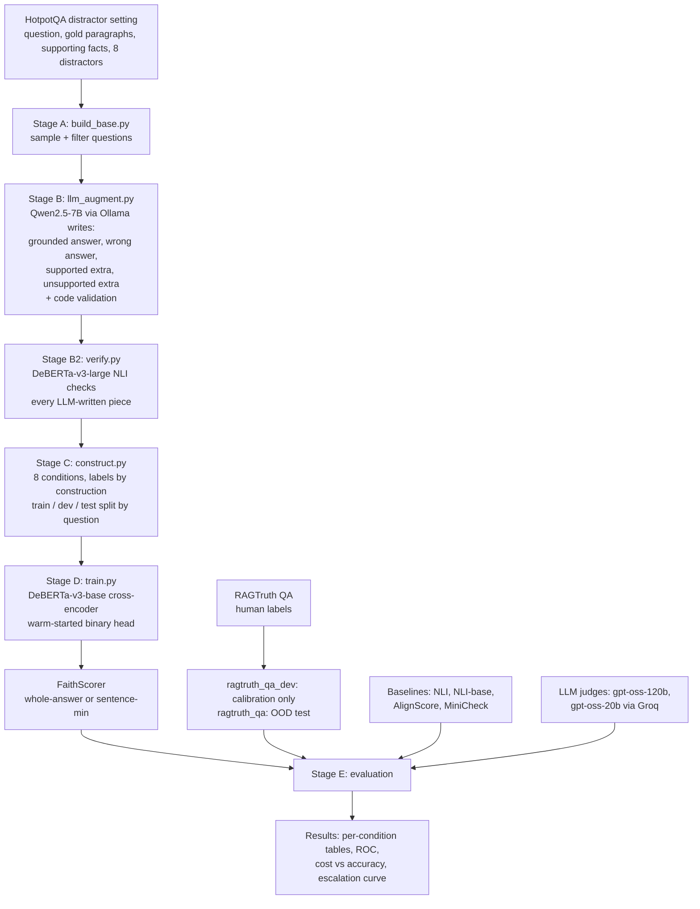

# FAITHSCORER: A LIGHTWEIGHT, RETRIEVAL-NOISE-ROBUST FAITHFULNESS SCORER FOR RETRIEVAL-AUGMENTED GENERATION, TRAINED WITH LABELS BY CONSTRUCTION

> **About this document.** This is the complete source material for the final-year project report (the repository's front page is `README.md`). Corrections made after the 14 October 2026 audit are marked *[corrected]*. It follows the structure in *Format for Preparation of Project Report* (Amrita School of Computing): front matter, Chapters 1–6, References, Appendices. Every number comes from files in this repository (`data/results/report.md`, `data/results/report.json`, `data/results/extra_stats.json`) and can be regenerated with the commands in Appendix C. Pages that need signatures or institutional wording (title/cover page layout, bonafide certificate, declaration) are only given as placeholders.
>
> **Status as of 7 October 2026: final.** All experiments are complete and all numbers are frozen. LLM-judge runs: gpt-oss-120b on 600 RAGTruth test examples, and gpt-oss-20b on a 200-example stratified sample of the constructed test set (25 per condition). Two further judge runs (120b on the constructed test, 20b on RAGTruth) could not finish under the free-tier daily token cap before the review; their partial outputs (35 and 25 examples) are kept in `data/judge/_partial/` and are not reported.

---

## FRONT MATTER

### Title page information

| Field | Value |
|---|---|
| Title | FaithScorer: A Lightweight, Retrieval-Noise-Robust Faithfulness Scorer for Retrieval-Augmented Generation, Trained with Labels by Construction |
| Report type | A Project Report |
| Submitted to | Amrita Vishwa Vidyapeetham |
| Degree | Bachelor of Technology in Computer Science and Engineering |
| Candidates | Tarun Ramkumar Gargeya (Reg. No. CH.SC.U4CSE23151); T S Akarsh Velan (Reg. No. CH.SC.U4CSE23150) |
| Team ID | BI 54 |
| Supervisor | Dr K. Deepak, Department of Computer Science and Engineering |
| Institution | Amrita School of Computing, Amrita Vishwa Vidyapeetham, Chennai – 601103 |
| Month & Year | October 2026 |

*(Bonafide certificate and declaration: use the institutional templates, Appendix 2a/2b and Appendix 3 of the format document.)*

### Abstract

Retrieval-Augmented Generation (RAG) grounds the output of a large language model (LLM) in passages fetched from an external corpus, but generators often drift from that evidence. They add unsupported details, contradict the retrieved text, ground only part of an answer, or ignore irrelevant passages and answer from memory. Detecting these *faithfulness* violations reliably currently depends on LLM-as-judge evaluation, which is accurate but too slow and costly to run on every answer. Lightweight scorers based on natural language inference (NLI), such as AlignScore and MiniCheck, are cheaper, but they have mostly been validated on clean benchmarks, not under the degraded retrieval where faithfulness checking matters most.

This project presents **FaithScorer**, a 184-million-parameter DeBERTa-v3 cross-encoder fine-tuned to judge whether an answer is faithful to its retrieved context. Its training data comes from a **labels-by-construction** method. Starting from multi-hop HotpotQA questions, a local LLM writes grounded answers and controlled perturbations, an independent NLI model verifies them, and a deterministic program assembles eight retrieval conditions: clean, distractor noise, counterfactual-followed, supported addition, counterfactual-contradicted, incomplete evidence, irrelevant context, and unsupported addition. Each label is known from how the example was built, which removes the need for judge-generated labels and separates *faithfulness* (agreement with the context) from *factual correctness*. A sentence-level aggregation step scores each answer sentence against the full context and flags the answer if any sentence is unsupported.

On a held-out constructed test set of 2,880 examples, FaithScorer reaches 0.961 balanced accuracy and 0.989 AUROC, against 0.881 / 0.941 for the best baseline (MiniCheck). It is the most accurate scorer in all eight conditions, and under distractor noise it keeps 97% accuracy on faithful answers where NLI and AlignScore fall to 59–60%. On RAGTruth, an out-of-distribution benchmark of real LLM answers with human hallucination labels, the sentence-level FaithScorer reaches 0.823 AUROC against 0.774 for AlignScore (paired bootstrap difference +0.048, 95% CI [0.001, 0.097]). With a threshold calibrated on RAGTruth's separate training split, its balanced accuracy is 0.747, compared with 0.797 for a 120-billion-parameter LLM judge (gpt-oss-120b) on the same 600 examples. In-domain, it outperforms a 20-billion-parameter LLM judge (gpt-oss-20b): 0.965 vs 0.880 balanced accuracy. FaithScorer runs locally in about 25–50 ms per answer, against about 1.2 s and a capped daily quota for the 120B judge. Sending only the least-confident 20% of answers to the judge makes the combined system as accurate as the judge alone (0.797 vs 0.797). The project also documents a failed first iteration and the design lessons drawn from it, a silent mixed-precision training bug and its diagnosis, and the limits of the approach: probability calibration across domains, and contradiction detection on real data.

**Keywords:** Retrieval-Augmented Generation, Hallucination Detection, Faithfulness Evaluation, Natural Language Inference, LLM-as-Judge, Synthetic Data, DeBERTa, Robustness

### Acknowledgement (draft — names to be completed by the team)

This project work would not have been possible without the contribution of many people. We express our gratitude to our Chancellor, **[name]**, for her blessings and for being a source of inspiration. We thank our Director, **[name]**, and our Principal, **[name]**, Amrita School of Computing, Chennai, for the facilities and support provided. We are grateful to **[Chairperson name]**, Chairperson, Department of Computer Science and Engineering. We express our sincere gratitude to our supervisor, **Dr K. Deepak**, for his guidance, involvement and encouragement throughout this work. We also thank the Project Coordinator, the review panel members and the faculty of the Department of Computer Science and Engineering for their constructive criticism and valuable suggestions.

*(Use the pronoun appropriate for the supervisor; adjust to match the institutional specimen.)*

### List of Tables

| Table No. | Title | Section |
|---|---|---|
| 2.1 | Summary of reviewed literature | 2.7 |
| 3.1 | Failures of the first iteration (v1) and the corresponding design changes | 3.3 |
| 3.2 | Retrieval conditions and labels by construction | 3.5 |
| 4.1 | Hardware and software environment | 4.2 |
| 4.2 | LLM-written fields and validation checks | 4.3.2 |
| 4.3 | Stage B validation failures | 4.3.2 |
| 4.4 | Independent NLI verification pass rates | 4.3.3 |
| 4.5 | Constructed dataset sizes per split | 4.3.4 |
| 4.6 | Constructed dataset sizes per condition | 4.3.4 |
| 4.7 | Worked example: one question, eight examples | 4.4 |
| 4.8 | FaithScorer training hyperparameters | 4.5 |
| 4.9 | Systems compared | 4.6 |
| 4.10 | Evaluation datasets | 4.8 |
| 5.1 | Headline results | 5.1 |
| 5.2 | Per-condition accuracy, constructed test set | 5.2 |
| 5.3 | Mean score on faithful answers, clean vs distractors | 5.3 |
| 5.4 | Answer aggregation ablation on RAGTruth | 5.4 |
| 5.5 | RAGTruth results with both threshold sources | 5.5 |
| 5.6 | Comparison with the LLM judge on the judged subset | 5.6 |
| 5.7 | Escalation results | 5.6 |
| 5.7a | In-domain comparison with gpt-oss-20b | 5.6 |
| 5.8 | Latency and cost | 5.7 |
| 5.9 | RAGTruth breakdown by hallucination type | 5.8 |
| 5.10 | RAGTruth breakdown by generator model | 5.8 |
| 5.11 | Confusion matrices on RAGTruth | 5.8 |
| 5.12 | FaithScorer vs AlignScore vs MiniCheck: design comparison | 5.9 |
| 5.13 | Trade-offs | 5.10 |
| 5.14 | Comparison with the first iteration (v1) | 5.12 |

### List of Figures

| Figure No. | Title | File |
|---|---|---|
| 4.1 | System architecture and data pipeline | Section 4.1 (diagram) |
| 5.1 | Distractor passages lower baseline scores on faithful answers | `data/results/figures/fig_noise_effect.png` |
| 5.2 | Per-condition accuracy heatmap | `data/results/figures/fig_condition_heatmap.png` |
| 5.3 | ROC curves on RAGTruth | `data/results/figures/fig_ragtruth_roc.png` |
| 5.4 | Escalation curve | `data/results/figures/fig_escalation.png` |
| 5.5 | Cost vs accuracy | `data/results/figures/fig_cost_accuracy.png` |
| 5.6 | Training curve | `data/results/figures/fig_training_curve.png` |

### List of Symbols and Abbreviations

| Symbol / Abbreviation | Meaning |
|---|---|
| RAG | Retrieval-Augmented Generation |
| LLM | Large Language Model |
| NLI | Natural Language Inference (entailment / neutral / contradiction) |
| MNLI, ANLI, FEVER | Multi-Genre NLI, Adversarial NLI, Fact Extraction and VERification datasets |
| QA | Question Answering |
| OOD | Out-of-distribution |
| AUROC | Area Under the Receiver Operating Characteristic curve |
| ROC | Receiver Operating Characteristic |
| F1 | Harmonic mean of precision and recall |
| CI | Confidence interval |
| κ | Cohen's kappa (chance-corrected agreement) |
| ms | Milliseconds |
| GPU / VRAM | Graphics Processing Unit / video memory |
| fp32, fp16, bf16 | 32-bit float, 16-bit float, bfloat16 number formats |
| API | Application Programming Interface |
| TPM / TPD | Tokens per minute / tokens per day (API rate limits) |
| CE | Cross-entropy loss |
| *C* | Retrieved context (one or more passages) |
| *A* | Generated answer |
| *s*ᵢ | The *i*-th sentence of answer *A* |
| *y* | Faithfulness label (1 = faithful, 0 = unfaithful) |
| *p*(*C*, *A*) | Scorer's probability that *A* is faithful to *C* |
| τ | Decision threshold |
| ŷ | Predicted label, ŷ = 1[*p* ≥ τ] |
| *k* | Fraction of answers escalated to the LLM judge |

---

## CHAPTER 1: INTRODUCTION

### 1.1 Background

Large language models generate fluent text but can state things that are false or unsupported, a behaviour usually called *hallucination* [13]. Retrieval-Augmented Generation (RAG) [16, 9] reduces this by retrieving passages relevant to the user's question from an external corpus and conditioning the generator on them. RAG is now the standard architecture for question answering over documents, enterprise search assistants and customer-support bots.

RAG does not remove hallucination; it changes its form. The generator can still:
- **add unsupported information:** details that appear nowhere in the retrieved passages;
- **contradict the context:** state something that conflicts with the retrieved evidence;
- **ground only part of the answer:** some claims are supported, others are not;
- **ignore the context and answer from memory:** especially when the retrieved passages are irrelevant or incomplete.

Retrieval itself is often imperfect. Retrievers return passages that are on-topic but don't contain the answer, passages that are incomplete, or passages that conflict with each other [6, 3]. These degraded conditions are exactly when a faithfulness check is most needed.

### 1.2 Faithfulness versus correctness

Two properties of a RAG answer are easily confused:

- **Faithfulness (groundedness):** every claim in the answer is supported by the retrieved context.
- **Correctness:** the answer is true in the real world.

They can disagree. If a retrieved document contains an error and the model repeats it, the answer is *faithful but wrong*. If the model ignores irrelevant context and answers correctly from its own training knowledge, the answer is *unfaithful but right*. A RAG guardrail must measure faithfulness, because the system's promise is that answers come *from the retrieved sources*, and only faithfulness can be checked without already knowing the truth. This project measures faithfulness only.

### 1.3 Motivation

1. **Cost and latency of LLM judges.** The most accurate way to check faithfulness today is to ask a strong LLM to compare the answer with the context (LLM-as-judge) [38, 7]. Running that on every answer of a production system doubles the number of LLM calls, adds about a second of latency, and costs money. On the free tier used in this project, the 120-billion-parameter judge was limited to about 285 judgments per day.
2. **Retrieval is rarely clean.** Real retrievers return related-but-irrelevant, incomplete and conflicting passages [6, 3, 21].
3. **Cheap scorers are validated on clean data.** NLI-based and distilled scorers (AlignScore [37], MiniCheck [31]) are fast, but their reported accuracy comes from benchmarks that don't systematically vary retrieval quality. A scorer that looks good on a leaderboard may fail silently under noise. In this project, adding distractor passages lowered AlignScore's mean score on faithful answers from 0.72 to 0.59, and plain NLI's from 0.44 to 0.14 (Section 5.3).

### 1.4 Objectives

1. Build a cheap faithfulness scorer, small enough to run locally on a laptop GPU in tens of milliseconds, that stays reliable under degraded retrieval.
2. Generate training and evaluation data whose labels do not depend on an expensive or unreliable LLM judge.
3. Keep faithfulness separate from factual correctness throughout.
4. Evaluate against existing lightweight scorers and LLM judges, broken down by retrieval condition, and on an independent human-labelled benchmark the model never trained on.
5. Quantify the cost/accuracy trade-off, including a hybrid that sends only uncertain cases to an LLM judge.

### 1.5 Contributions

1. **Labels-by-construction data generation for RAG faithfulness.** A pipeline (HotpotQA → local-LLM text generation → independent NLI verification → deterministic assembly) that produces eight retrieval conditions with balanced faithful and unfaithful examples, including *minimal pairs* that differ in one controlled respect.
2. **Faithfulness explicitly separated from correctness,** through paired counterfactual conditions (faithful-but-false vs correct-but-contradicting).
3. **FaithScorer:** a 184M-parameter cross-encoder with a warm-started binary head, plus sentence-level min-aggregation. It is best in-domain under all retrieval conditions and beats AlignScore, MiniCheck and NLI baselines on real human-labelled hallucinations (RAGTruth).
4. **A condition-level evaluation** of existing lightweight scorers, showing that distractor noise and counterfactual contexts expose failures that clean benchmarks hide.
5. **A cost/accuracy analysis against LLM judges,** including an escalation scheme that matches the 120B judge's accuracy while sending only 20% of answers to it, and an in-domain comparison where the 184M scorer beats a 20B judge.
6. **An honest record of what failed:** a first iteration (v1) and the reasons it failed, a silent fp16 training collapse and its diagnosis, and the remaining limitations (calibration across domains, contradiction recall on real data).

### 1.6 Scope

- **In scope:** English, extractive and short-to-medium-length question answering over provided passages; binary faithfulness per answer; Wikipedia-style training contexts; evaluation on HotpotQA-derived data and RAGTruth QA (MS MARCO-based).
- **Out of scope:** checking the factual truth of the context itself; summarisation and data-to-text tasks; multilingual input; locating the exact unfaithful span (the sentence-level scores give a partial indication); building the retriever or generator of a RAG system.

### 1.7 Organisation of the report

Chapter 2 reviews RAG robustness, hallucination benchmarks, LLM-as-judge and lightweight faithfulness scorers. Chapter 3 states the problem formally, describes the failed first iteration, and presents the methodology. Chapter 4 describes the system design, dataset construction, model training and experimental setup. Chapter 5 presents and discusses the results. Chapter 6 concludes and outlines future work.

---

## CHAPTER 2: LITERATURE REVIEW

### 2.1 Retrieval-Augmented Generation

Lewis et al. [16] introduced RAG, which combines a dense retriever with a sequence-to-sequence generator for knowledge-intensive tasks. Gao et al. [9] survey the many later variants (naive, advanced and modular RAG). All of them assume the retrieved evidence is used faithfully, which is the assumption this project tests.

### 2.2 Robustness of RAG to noisy retrieval

- **The Power of Noise** (Cuconasu et al. [6]) shows that *related-but-irrelevant* documents hurt generation more than random ones. This motivates our hard-negative distractors, taken from HotpotQA's own retrieved distractors.
- **RGB** (Chen et al. [3]) benchmarks LLMs on noise robustness, negative rejection, information integration and counterfactual robustness.
- **RAAT** (Fang et al. [8]) categorises retrieval noise as *relevant* (on-topic but lacking the answer), *irrelevant* and *counterfactual*, and trains generators to be robust to it. Our condition set extends this taxonomy. *[corrected]*
- **FaithEval** (Ming et al. [21]) tests whether LLMs stay faithful to unanswerable, inconsistent and counterfactual contexts.

These works study the *generator's* robustness. This project studies the robustness of the *evaluator* that checks the generator.

### 2.3 Hallucination and faithfulness benchmarks

- **Hallucination survey** (Ji et al. [13]): taxonomy of intrinsic (contradicting the source) and extrinsic (unverifiable from the source) hallucination. Our conditions cover both: `cf_contradicted` is intrinsic; `unsupported_extra`, `incomplete` and `irrelevant` are extrinsic.
- **RAGTruth** (Niu et al. [23]): about 18,000 responses from six LLMs on QA, summarisation and data-to-text, with human span-level labels of four types (evident/subtle conflict, evident/subtle baseless info). We use its QA test split as the out-of-distribution evaluation and a sample of its training split for calibration only.
- **TRUE** (Honovich et al. [12]) and **SummaC** (Laban et al. [14]): factual-consistency benchmarks and NLI-based detectors for summarisation. SummaC showed that NLI works much better when applied at sentence level, which is consistent with our sentence-level finding.
- **FActScore** (Min et al. [20]): decomposes long generations into atomic facts and checks each against a knowledge source.
- **SelfCheckGPT** (Manakul et al. [19]): detects hallucination without references, from sampling consistency.

### 2.4 LLM-as-judge and RAG evaluation frameworks

- **LLM-as-a-judge** (Zheng et al. [38]): strong LLMs agree well with human preferences but have biases (position, verbosity, self-preference).
- **G-Eval** (Liu et al. [17]): GPT-4 with chain-of-thought for NLG evaluation.
- **RAGAS** (Es et al. [7]): reference-free RAG metrics, including faithfulness, computed by prompting an LLM.
- **ARES** (Saad-Falcon et al. [30]): fine-tunes lightweight LM judges on synthetic data and uses prediction-powered inference with a small human-labelled set. This is the closest analogue to our "cheap judge plus small labelled calibration set" design.
- **RAGChecker** (Ru et al. [29]): fine-grained, claim-level diagnosis of retrieval and generation errors, using LLM-based claim extraction and checking.
- **Lynx** (Ravi et al. [28]): open-source hallucination-detection LLMs (8B/70B) fine-tuned for RAG faithfulness.

These frameworks are accurate but rely on LLM calls, the cost this project tries to avoid.

### 2.5 Lightweight faithfulness scorers

- **NLI cross-encoders** trained on MNLI [34], FEVER [32] and ANLI [22] can score whether a context entails an answer. They are cheap but sensitive to input length and distribution shift [14, 12].
- **AlignScore** (Zha et al. [37]): a RoBERTa [18] model trained on a unified "alignment" function over about 4.7M examples from 7 task types (NLI, fact verification, paraphrase, semantic similarity, QA, information retrieval, summarisation consistency). At inference it chunks the context and splits the claim into sentences.
- **MiniCheck** (Tang et al. [31]): small fact-checkers (RoBERTa-large, DeBERTa-v3-large and Flan-T5-large [4]) trained on GPT-4-generated synthetic data (plus ANLI for the DeBERTa and Flan-T5 variants) designed to need multi-sentence reasoning. It reports near-GPT-4 accuracy on the LLM-AggreFact benchmark at far lower cost.
- **HHEM** (Vectara [33]): an open hallucination-evaluation classifier based on Flan-T5.
- **Embedding similarity** heuristics (cosine between answer and context embeddings) are cheapest of all but measure topical similarity, not support.

### 2.6 Synthetic data for faithfulness

MiniCheck [31] and ARES [30] both show that synthetic training data can produce strong small checkers. Our method differs in **what** it synthesises: instead of general claim/document pairs, it builds *retrieval-condition* pairs (distractors, edits, deletions, additions) around the same question. That gives minimal pairs that isolate each failure type, plus explicit faithful-but-false examples.

### 2.7 Summary of reviewed literature

**Table 2.1 – Summary of reviewed literature**

| # | Work | Approach | Strength | Limitation relevant to this project |
|---|---|---|---|---|
| 1 | RAG, Lewis et al. 2020 [16] | Retriever + generator | Foundational architecture | Assumes evidence is used faithfully |
| 2 | Power of Noise, Cuconasu et al. 2024 [6] | Inject noise into RAG retrieval | Related-but-irrelevant docs hurt most | Studies generators, not evaluators |
| 3 | RGB, Chen et al. 2024 [3] | Benchmark of 4 RAG abilities | Includes counterfactual robustness | No evaluator robustness study |
| 4 | RAAT, Fang et al. 2024 [8] | Adversarial training for noise | Noise taxonomy | Generator-side only |
| 5 | FaithEval, Ming et al. 2025 [21] | Counterfactual/unanswerable contexts | Tests context faithfulness | LLM-side benchmark |
| 6 | RAGTruth, Niu et al. 2024 [23] | Human span-level labels | Real hallucinations, 6 LLMs | Clean retrieval; not noise-controlled |
| 7 | Hallucination survey, Ji et al. 2023 [13] | Taxonomy | Intrinsic/extrinsic distinction | Survey |
| 8 | TRUE, Honovich et al. 2022 [12] | Consistency benchmark | Standardised evaluation | Mostly summarisation |
| 9 | SummaC, Laban et al. 2022 [14] | Sentence-level NLI | Shows granularity matters | Summarisation domain |
| 10 | FActScore, Min et al. 2023 [20] | Atomic-fact checking | Fine-grained | LLM-based, costly |
| 11 | SelfCheckGPT, Manakul et al. 2023 [19] | Sampling consistency | No references needed | Many LLM samples per answer |
| 12 | LLM-as-a-judge, Zheng et al. 2023 [38] | Strong LLM as evaluator | High human agreement | Expensive, biased |
| 13 | G-Eval, Liu et al. 2023 [17] | GPT-4 + CoT scoring | Flexible | Expensive |
| 14 | RAGAS, Es et al. 2024 [7] | LLM-prompted RAG metrics | Reference-free | LLM calls per answer |
| 15 | ARES, Saad-Falcon et al. 2024 [30] | Lightweight judges + PPI | Cheap, small human set | Not noise-stratified |
| 16 | RAGChecker, Ru et al. 2024 [29] | Claim-level diagnosis | Fine-grained | LLM-based |
| 17 | Lynx, Ravi et al. 2024 [28] | Fine-tuned 8B/70B judge | Strong RAG faithfulness | Multi-billion parameters |
| 18 | AlignScore, Zha et al. 2023 [37] | Unified alignment, 4.7M examples | Broad, strong baseline | Not trained on retrieval noise |
| 19 | MiniCheck, Tang et al. 2024 [31] | Synthetic data, small checkers | Near-GPT-4 at low cost | Clean documents; no distractors |
| 20 | HHEM, Vectara 2024 [33] | Flan-T5 classifier | Open, practical | No retrieval-noise evaluation |
| 21 | DeBERTaV3, He et al. 2023 [10] | Improved encoder pre-training | Strong NLI backbone | — (used as our base) |
| 22 | HotpotQA, Yang et al. 2018 [36] | Multi-hop QA with distractors | Supporting facts + hard negatives | — (used as our source data) |

### 2.8 Research gap

1. Existing lightweight scorers have **not been systematically tested under controlled retrieval degradation** (distractors, counterfactual edits, missing evidence, irrelevant context).
2. Most training data for checkers **mixes faithfulness with plausibility**: it rarely contains examples where the faithful answer is factually false.
3. No cheap scorer has been shown to **approach LLM-judge accuracy on real hallucinations** while staying robust to retrieval noise.

This project addresses all three: a noise-stratified evaluation, a training set with faithful-but-false minimal pairs, and an out-of-distribution comparison with LLM judges on human-labelled data.

---

## CHAPTER 3: PROBLEM STATEMENT AND METHODOLOGY

### 3.1 Problem statement

RAG systems ground LLM outputs in external evidence, but generators often drift from retrieved context through unsupported additions, contradictions, partial grounding, or answering confidently from parametric memory while ignoring irrelevant passages. Detecting these faithfulness violations reliably relies on LLM-as-judge evaluation, which is accurate but too slow and expensive for real-time guardrails or large-scale benchmarking. Lightweight alternatives (NLI-based entailment scorers, distilled classifiers, embedding-similarity heuristics) are cheaper approximations, but none has been systematically tested under degraded or adversarial retrieval (noisy, related-but-irrelevant, incomplete or contradictory context), which is exactly where faithfulness evaluation matters most.

**Open gap:** no cheap, robust faithfulness scorer has been shown to match LLM-as-judge performance under real-world retrieval-noise conditions, not just on clean benchmarks.

### 3.2 Formal definition

Given a retrieved context *C* (one or more passages) and an answer *A* with sentences *s*₁, …, *s*ₙ:

- **Faithfulness label (Eq. 3.1):** *y*(*C*, *A*) = 1 if every claim in *A* is supported by *C*, otherwise 0.
- **Scorer:** a function *p*(*C*, *A*) ∈ [0, 1] estimating P(*y* = 1).
- **Decision (Eq. 3.2):** ŷ = 1[*p*(*C*, *A*) ≥ τ], with τ chosen on a development set.

The label depends only on (*C*, *A*), never on whether *A* is true in the real world.

### 3.3 First iteration (v1) and lessons learned

The project's first iteration (repository `fyproject2`, presented at the Phase II review on 17–18 September 2026) stress-tested NLI, AlignScore and MiniCheck under five corruption types on 200 SQuAD questions, used Llama 3.2 (3B) as the generator, and trained a logistic-regression combiner on Gemini-judge labels. It did not produce a usable result. Its failure modes shaped every design decision in the final system.

**Table 3.1 – Failures of the first iteration and the corresponding design changes**

| Problem in v1 | Evidence | Design change in the final system |
|---|---|---|
| The generator refused to answer under most noise conditions, so those conditions produced almost no data | 99.5% / 95% / 87% "I don't know" on random / related / incomplete contexts; only 1 / 10 / 26 judged examples | Answers and violations are **constructed**, so every condition has balanced data |
| Labels mixed faithfulness with gold-answer correctness | An answer faithfully repeating a counterfactual context was labelled wrong; all scorers scored 0.05–0.36 on counterfactual | Labels depend **only** on (context, answer); `cf_followed` is labelled faithful |
| Ground truth came from free-tier LLM judges that disagreed with themselves | 3 different Gemini models; re-labelling agreement κ = 0.50 | Labels come from **construction**; LLM judges are **baselines**, not ground truth |
| Small, easy data | 200 SQuAD questions, 356 labels, one-phrase answers | 2,500 + 600 multi-hop HotpotQA questions, 1–2 sentence answers, 14.5k examples |
| The "model" was a logistic regression over 3 off-the-shelf scores | Macro-F1 0.43; cannot represent context–answer interactions | A cross-encoder **fine-tuned end-to-end** on the task |
| A "context reliance" feature (answer with vs without context) showed no gain | Confidence interval of the improvement included 0 | Dropped |

### 3.4 Methodology overview

1. **Source questions with known evidence.** HotpotQA (distractor setting) [36] gives, for each question, two gold paragraphs, the exact supporting sentences, and eight related distractor paragraphs.
2. **LLM-written text, not LLM labels.** A local LLM (Qwen2.5-7B-Instruct [27]) writes a grounded answer, a same-type wrong answer, one supported extra sentence and one unsupported extra sentence. Code checks every output.
3. **Independent verification.** A larger NLI model (DeBERTa-v3-large) that is not one of the evaluated scorers checks every LLM-written piece against the gold paragraphs.
4. **Labels by construction.** A deterministic program assembles eight (context, answer) conditions whose labels follow from how they were built.
5. **Model.** An NLI-pretrained DeBERTa-v3-base [10] cross-encoder is fine-tuned as a binary faithfulness classifier, with its head warm-started from the NLI entailment head.
6. **Sentence-level aggregation.** At inference, each answer sentence is scored against the full context and the minimum is taken.
7. **Evaluation.** In-domain per-condition analysis; out-of-distribution evaluation on RAGTruth's human labels; comparison with LLM judges; latency and cost; an escalation scheme.

### 3.5 Retrieval conditions and labels by construction

**Table 3.2 – Retrieval conditions and labels by construction**

| Condition | Context given to the scorer | Answer | Label | Failure type tested |
|---|---|---|---|---|
| `clean` | Gold paragraphs | Grounded answer | Faithful | — |
| `noisy` | Gold + 2–3 hard-negative distractors | Grounded answer | Faithful | False alarms under noise |
| `cf_followed` | Gold with the answer swapped for a wrong one | Answer using the wrong value | **Faithful** (but factually wrong) | Faithfulness ≠ correctness |
| `supported_extra` | Gold | Grounded answer + a sentence the context supports | Faithful | Grounded elaboration |
| `cf_contradicted` | Gold with the answer swapped | Original (correct) grounded answer | Unfaithful | Contradiction / answering from memory |
| `incomplete` | Gold minus the answer-bearing sentence | Grounded answer | Unfaithful | Partial grounding / missing evidence |
| `irrelevant` | Related-but-non-answering distractors only | Grounded answer | Unfaithful | Ignoring context, answering from memory |
| `unsupported_extra` | Gold | Grounded answer + an invented sentence | Unfaithful | Unsupported addition |

Design rules that block shortcuts:
- Distractors are added with probability 0.5 to every condition except `irrelevant` (distractors only) and `noisy` (always), so the *presence* of distractors does not predict the label.
- Both faithful and unfaithful answers can carry an extra sentence (`supported_extra` vs `unsupported_extra`), so answer length doesn't predict the label.
- Paragraph order is shuffled.
- The minimal pairs (`clean`/`incomplete`, `cf_followed`/`cf_contradicted`, `supported_extra`/`unsupported_extra`) differ in exactly one controlled respect.

### 3.6 Model

FaithScorer is a cross-encoder: context and answer are concatenated as `[CLS] C [SEP] A [SEP]` and passed through DeBERTa-v3-base (184M parameters) [10, 11], whose `[CLS]` representation *h* feeds a linear head.

- **Output (Eq. 3.3):** *p*(*C*, *A*) = softmax(*W h* + *b*)₁
- **Loss (Eq. 3.4):** cross-entropy, *L* = −[*y* log *p* + (1 − *y*) log(1 − *p*)]
- **Warm-started head (Eq. 3.5):** the starting checkpoint's 3-way NLI head (entailment, neutral, contradiction) is converted to a 2-way head with
  - *w*_faithful = *w*_entailment, *b*_faithful = *b*_entailment
  - *w*_unfaithful = (*w*_neutral + *w*_contradiction) / 2, and likewise for *b*

  so training starts from the zero-shot NLI model instead of a random head.

### 3.7 Sentence-level aggregation

RAGTruth answers are long and multi-sentence; one unsupported sentence makes the whole answer unfaithful, but in a single whole-answer pass its effect gets diluted. At inference, the answer is split into sentences *s*₁…*s*ₙ (NLTK Punkt), each sentence is scored against the **full** context, and the answer score is the minimum:

**(Eq. 3.6)** *p*_sent(*C*, *A*) = minᵢ *p*(*C*, *s*ᵢ)

A mean-aggregation variant, *p*_mean = (1/*n*) Σᵢ *p*(*C*, *s*ᵢ), was also evaluated. The choice between whole, mean and min was made on RAGTruth's *training* split, before looking at its test split (Section 5.4).

### 3.8 Evaluation protocol and metrics

- **Thresholds.** For every scorer, τ is tuned on the constructed dev split to maximise balanced accuracy, then frozen. For RAGTruth a second, deployment-style calibration tunes τ on 900 examples from RAGTruth's *training* split (disjoint questions), again for every scorer alike. Nothing is tuned on any test split.
- **Balanced accuracy (Eq. 3.7)** [2]: BA = ½ (TPR + TNR). Used as the primary decision metric because RAGTruth is imbalanced (82% faithful).
- **F1 on the unfaithful class (Eq. 3.8):** F1 = 2PR / (P + R), with unfaithful as the positive class.
- **AUROC:** threshold-free ranking quality; the probability that a random faithful answer scores higher than a random unfaithful one.
- **Cohen's κ (Eq. 3.9)** [5]: κ = (*p*ₒ − *p*ₑ) / (1 − *p*ₑ), agreement with the LLM judge beyond chance.
- **Per-condition accuracy:** the fraction of each constructed condition classified correctly.
- **Escalation (Eq. 3.10):** confidence *c* = |logit(*p*) − logit(τ)|, the distance from the threshold in log-odds, where logit(*p*) = ln(*p* / (1 − *p*)). The fraction *k* of answers with the lowest *c* is sent to the LLM judge, and the rest keep FaithScorer's decision. Balanced accuracy is reported as a function of *k*. (Log-odds matter here: with a threshold near 0, the raw distance |*p* − τ| would rank the most confidently rejected answers as the "least confident". An earlier version of the analysis had this flaw; correcting it raised the 20%-escalation result from 0.787 to 0.797.)
- **Significance:** paired bootstrap over RAGTruth source questions (2,000 resamples) for AUROC differences.
- **Latency:** wall-clock milliseconds per example on an otherwise idle GPU (batch 16), and API round-trip time for judges.

### 3.9 Hypotheses

- **H1:** Off-the-shelf lightweight scorers degrade under distractor noise and counterfactual contexts.
- **H2:** A scorer trained on labels by construction is robust across all eight conditions in-domain.
- **H3:** The trained scorer transfers to real hallucinations (RAGTruth) at least as well as the best lightweight baseline.
- **H4:** Combining the cheap scorer with an LLM judge on uncertain cases approaches judge accuracy at a fraction of the judge calls.

---

## CHAPTER 4: SYSTEM DESIGN AND EXPERIMENTAL WORK

### 4.1 System architecture

**Figure 4.1 – System architecture and data pipeline**



Text form of the same pipeline:

```
HotpotQA ─► Stage A (sample) ─► Stage B (LLM writes text + checks) ─► Stage B2 (NLI verify)
        ─► Stage C (8 labelled conditions) ─► Stage D (fine-tune DeBERTa) ─► FaithScorer
FaithScorer + baselines + LLM judges ─► Stage E (constructed test, RAGTruth OOD, cost, escalation)
```

**Deployment view:** in a RAG system, FaithScorer sits after generation. It receives the retrieved context and the generated answer, returns P(faithful), and (optionally) escalates uncertain cases to an LLM judge.

### 4.2 Hardware and software

**Table 4.1 – Hardware and software environment**

| Component | Specification |
|---|---|
| Machine | ASUS ROG Strix G16 laptop |
| GPU | NVIDIA GeForce RTX 5070 Ti Laptop GPU, 12 GB VRAM (Blackwell; requires a CUDA 12.8+ PyTorch build) |
| RAM | 16 GB |
| OS | Windows 11 |
| Python | 3.12 (virtual environment created with `uv`) |
| Deep learning | PyTorch 2.11 (cu128 build), Hugging Face Transformers 5.x [35], Datasets |
| Classical ML / metrics | scikit-learn [26], NumPy |
| Local LLM serving | Ollama, Qwen2.5-7B-Instruct (4-bit, ~4.7 GB) |
| Hosted LLM judges | Groq API (free tier): `openai/gpt-oss-120b`, `openai/gpt-oss-20b` [24], via the `openai` client |
| Baseline libraries | AlignScore [37], MiniCheck [31] (patched for current library versions, see Appendix D) |
| Other | NLTK (sentence splitting), spaCy, matplotlib |
| Cost | ₹0. Local generation; free-tier API only |

### 4.3 Dataset construction

#### 4.3.1 Stage A: base question sets (`src/data/build_base.py`)

- **Source:** HotpotQA, distractor setting [36]. Each question has 2 gold paragraphs, sentence-level supporting facts, and 8 distractor paragraphs retrieved by bigram TF-IDF similarity to the question, which makes them natural related-but-irrelevant hard negatives.
- **Splits:** train questions from HotpotQA *train* (90,447 questions); test questions from HotpotQA *validation* (7,405). No question is shared. Both splits draw on the same Wikipedia dump, so some paragraphs recur: 27 of the 369 test questions have a gold paragraph that also appears somewhere in the training data. Removing those questions leaves every result unchanged to within 0.004 (FaithScorer sent-min 0.960 vs 0.961 balanced accuracy; `src/eval/extra_checks.py`). *[corrected]*
- **Filters:**
  - skip yes/no questions;
  - require exactly 2 gold paragraphs;
  - the gold answer must appear verbatim in **exactly one** supporting sentence **and nowhere else** in the gold paragraphs. That sentence is what later gets swapped or deleted, so the edit is guaranteed to change what the context supports.
- **Output:** 2,500 train and 600 test questions (random sample, seed 42).

#### 4.3.2 Stage B: LLM-written text (`src/data/llm_augment.py`)

A local LLM (Qwen2.5-7B-Instruct, served by Ollama on the laptop GPU, JSON output mode, temperature 0.3, one retry at 0.7) writes four fields per question (prompt in Appendix A.1). The LLM never assigns labels.

**Table 4.2 – LLM-written fields and validation checks**

| Field | Content | Code checks |
|---|---|---|
| `grounded_answer` | 1–2 sentence answer from the supporting facts only, containing the gold answer | Contains gold answer; ≤ 50 words; no meta-commentary ("according to the passage", "supporting fact", …) |
| `wrong_answer` | Plausible same-type replacement for the gold answer | Doesn't overlap the gold answer; doesn't appear anywhere in the context |
| `supported_extra` | One extra sentence whose content is stated in the paragraphs | Not identical to the unsupported extra; no meta-commentary |
| `unsupported_extra` | One plausible, specific sentence **not** stated anywhere in the paragraphs | No meta-commentary |

Engineering details: a 400-token output cap and a 90-second request timeout stop runaway JSON-mode generations, which stalled an early run. Four parallel workers; about 2 seconds per question; resumable checkpoints.

**Table 4.3 – Stage B validation failures**

| | Train | Test |
|---|---|---|
| Questions processed | 2,500 | 600 |
| Passed all checks | 1,621 (64.8%) | 397 (66.2%) |
| Wrong answer overlaps gold/context | 648 | 153 |
| Missing JSON key | 97 | 21 |
| Grounded answer lacks gold answer | 79 | 18 |
| Meta-commentary | 52 | 10 |
| Malformed JSON | 3 | 1 |

#### 4.3.3 Stage B2: independent NLI verification (`src/data/verify.py`)

A manual spot-check of 12 random Stage B rows found one grounded answer with an unsupported claim ("…based in Beijing, which is the capital city of Morocco…"). It passed the string check because the gold answer "Rabat" appears inside "Rabat-Salé-Kénitra". Left in, it would have put a hallucinated answer under a *faithful* label. Two of the 12 unsupported extras contradicted the context rather than merely adding to it (still correctly unfaithful).

Every LLM-written piece is therefore checked against the gold paragraphs by `MoritzLaurer/DeBERTa-v3-large-mnli-fever-anli-ling-wanli`, a large NLI model that is **not** one of the evaluated scorers (FaithScorer starts from the *base*-size sibling).

**Table 4.4 – Independent NLI verification pass rates (P(entailment) threshold 0.5)**

| Check | Rule if failed | Train pass | Test pass |
|---|---|---|---|
| Grounded answer entailed | Whole question dropped | 1,515 / 1,621 (93%) | 369 / 397 (93%) |
| Supported extra entailed | `supported_extra` condition skipped | 1,595 (98%) | 390 (98%) |
| Unsupported extra **not** entailed | `unsupported_extra` condition skipped | 1,597 (99%) | 389 (98%) |

The 7% drop rate for grounded answers matches the hand estimate (1 in 12). The dropped answers are genuine slip-ins, e.g. "…with a production budget of $750,000". Known bias: kept examples are ones this NLI model agrees with, which may slightly favour NLI-style baselines on the constructed test set. RAGTruth is unaffected.

#### 4.3.4 Stage C: labels by construction (`src/data/construct.py`)

Each verified question yields up to 8 examples (Table 3.2). Sanity check: for `cf_contradicted`, `cf_followed`, `incomplete` and `irrelevant`, the example is dropped if the gold answer string still appears in the context. The train questions are split 90/10 into train and dev **by question**. Each split has its own fixed random seed, so rebuilding one split never changes another (verified byte-for-byte).

**Table 4.5 – Constructed dataset sizes per split**

| Split | Source | Questions | Examples | Faithful | Unfaithful |
|---|---|---|---|---|---|
| train | HotpotQA train | 1,364 | 10,509 | 5,374 | 5,135 |
| dev | HotpotQA train (held-out questions) | 151 | 1,169 | 595 | 574 |
| test | HotpotQA validation | 369 | 2,880 | 1,462 | 1,418 |

**Table 4.6 – Constructed dataset sizes per condition**

| Condition | Label | Train | Dev | Test |
|---|---|---|---|---|
| clean | F | 1,364 | 151 | 369 |
| noisy | F | 1,364 | 151 | 369 |
| cf_followed | F | 1,300 | 145 | 361 |
| supported_extra | F | 1,346 | 148 | 363 |
| cf_contradicted | U | 1,284 | 142 | 357 |
| incomplete | U | 1,295 | 147 | 357 |
| irrelevant | U | 1,214 | 135 | 343 |
| unsupported_extra | U | 1,342 | 150 | 361 |

Input length (constructed test, DeBERTa tokens): median 359, 90th percentile 646, 99th percentile 959, maximum 1,673. The 1,024-token limit covers 99% of examples.

### 4.4 Worked example

Question: *"In which film did Emilio Estevez star in in the same year as Nightmares?"* Gold answer: *The Outsiders*. Context: the paragraphs "Nightmares (1983 film)" and "Emilio Estevez".

Qwen's output (real):
- **grounded_answer:** "In the same year as Nightmares, Emilio Estevez starred in The Outsiders, which is mentioned as one of his Brat Pack films from 1983."
- **wrong_answer:** "The Terminator"
- **supported_extra:** "Nightmares is an American horror anthology film."
- **unsupported_extra:** "Emilio Estevez won an Academy Award for his role in The Outsiders."

**Table 4.7 – Worked example: one question, eight examples**

| # | Context | Answer | Label |
|---|---|---|---|
| 1 | Real paragraphs | Grounded answer | Faithful |
| 2 | Real paragraphs + distractors | Grounded answer | Faithful |
| 3 | Paragraphs with "The Outsiders" → "The Terminator" | Answer saying The Terminator | Faithful (wrong in reality, but matches the context) |
| 4 | Real paragraphs | Grounded answer + "Nightmares is an American horror anthology film." | Faithful |
| 5 | Paragraphs with "The Terminator" planted | Answer saying The Outsiders | Unfaithful (contradicts the context) |
| 6 | Paragraphs with the Outsiders sentence deleted | Grounded answer | Unfaithful (not supported) |
| 7 | Distractor paragraphs only | Grounded answer | Unfaithful (answered from memory) |
| 8 | Real paragraphs | Grounded answer + "…won an Academy Award…" | Unfaithful (invented addition) |

Rows 3 and 5 show the core idea: the same answer is faithful or unfaithful depending only on the context.

### 4.5 Model training (`src/model/train.py`)

**Table 4.8 – FaithScorer training hyperparameters**

| Setting | Value |
|---|---|
| Starting checkpoint | `MoritzLaurer/DeBERTa-v3-base-mnli-fever-anli` [15] (DeBERTa-v3-base fine-tuned on MNLI, FEVER-NLI, ANLI) |
| Parameters | 184M |
| Head | 2-way, warm-started from the 3-way NLI head (Eq. 3.5) |
| Input | `[CLS] context [SEP] answer [SEP]`, max 1,024 tokens, truncating the context only |
| Loss | Cross-entropy |
| Optimiser | AdamW, learning rate 1e-5, weight decay 0.01 |
| Schedule | Linear, 10% warmup |
| Batch | 4 × 4 gradient accumulation = effective 16 |
| Epochs / steps | 2 / 1,314 |
| Precision | bf16 autocast with **fp32 master weights** |
| Memory | Gradient checkpointing; ~6 GB VRAM |
| Model selection | Best dev balanced accuracy, evaluated every 200 steps |
| Training time | ~25 minutes on the RTX 5070 Ti laptop GPU |
| Seed | 42 |

**Training curve:** dev AUROC rose from 0.863 (zero-shot starting model) to 0.981 after 0.3 epochs and peaked at 0.989. Dev balanced accuracy reached 0.966 (Figure 5.6).

**Debugging the first training run.** The first full run collapsed to a constant prediction (dev AUROC 0.50 at every checkpoint, loss spikes to 21, gradient norms above 400). Diagnosis:

1. A 150-step sanity run with the warm-started head still gave AUROC 0.50, even though almost no learning had happened. That ruled out "the model failed to learn" and pointed to the training loop.
2. The same model scored correctly **outside** the trainer (AUROC 0.92 on a 96-example dev sample), in fp32, in bf16 autocast, and with gradient checkpointing. So the model and data were fine.
3. Inspecting a collated batch showed correct inputs and labels.
4. Inside the trainer, the model's parameters were **fp16**: Transformers 5.x loads this checkpoint in its stored fp16 by default, so the weights themselves were being trained in fp16. Small updates round to zero or overflow, which is a known cause of collapse.

**Fix:** load in fp32 (`dtype=torch.float32`) so the trainer applies proper mixed precision. After the fix, dev AUROC was 0.981 after 150 steps. A second issue also contributed: a randomly re-initialised 2-way head produced a large initial loss; the warm-started head (Eq. 3.5) fixes that too. Earlier run-time issues were also fixed: batch size 8 at 1,024 tokens ran out of memory (now 4 × 4 accumulation), and `warmup_ratio` was removed in Transformers 5.x (now converted to steps).

### 4.6 Systems compared

**Table 4.9 – Systems compared**

| System | Type | Parameters | Notes |
|---|---|---|---|
| `nli`: cross-encoder/nli-deberta-v3-base | Off-the-shelf NLI | 184M | P(entailment) over the whole context, 512 tokens |
| `nli_base`: our starting checkpoint, zero-shot | Off-the-shelf NLI | 184M | Isolates the effect of our fine-tuning |
| `alignscore`: AlignScore-base [37] | Unified alignment model | 125M | `nli_sp` mode (chunks context, splits claims into sentences) |
| `minicheck`: MiniCheck Flan-T5-large [31] | Distilled fact-checker | 770M | Chunks document, max over chunks |
| **`faithscorer`** (ours, whole answer) | Fine-tuned cross-encoder | 184M | One pass over context + answer |
| **`faithscorer_sent`** (ours, sentence-min, **headline**) | Fine-tuned cross-encoder | 184M | Eq. 3.6 |
| `faithscorer_mean` (ours, sentence-mean, ablation) | Fine-tuned cross-encoder | 184M | Mean over sentences |
| gpt-oss-120b judge [24] | LLM-as-judge (hosted) | 117B total, 5.1B active (MoE) | Groq free tier, low reasoning effort |
| gpt-oss-20b judge [24] | LLM-as-judge (hosted) | 21B total, 3.6B active (MoE) | Groq free tier, low reasoning effort |

**Dropped baseline:** Vectara HHEM-2.1-Open [33]. Its custom code does not load its weights under Transformers 5.x (the weights are re-initialised, producing random outputs), so it was excluded rather than reported with broken numbers.

### 4.7 LLM-judge setup (`src/eval/llm_judge.py`)

- **Prompt (Appendix A.2):** asks for a one-word verdict (faithful/unfaithful), defines faithfulness as "every claim supported by the context, even if true in the real world", and **never shows the gold answer**. (Showing the gold answer was one of v1's mistakes.)
- **Settings:** temperature 0, low reasoning effort, up to 512 output tokens (room for hidden reasoning tokens).
- **Rate limits (free tier):** 1,000 requests/day, 8,000 tokens/minute and **200,000 tokens/day per model**, about 285 judgments/day for ~700-token prompts. The script reads the server's "try again in X" message and waits exactly that long; it is resumable and checkpoints every 5 results.
- **Samples (final):** gpt-oss-120b judged the first 600 RAGTruth test examples in file order (100 source questions × 6 generators). gpt-oss-20b judged a stratified sample of the constructed test set, 25 per condition (200). Each model's daily token budget (about 285 judgments) went to its main run; the cross runs reached only 35 and 25 examples before the review and are not reported.
- **Role:** judges are baselines and escalation targets. They never produce training or evaluation labels.

### 4.8 Evaluation datasets

**Table 4.10 – Evaluation datasets**

| Dataset | Source | Size | Faithful / unfaithful | Used for |
|---|---|---|---|---|
| Constructed dev | HotpotQA train (held-out questions) | 1,169 | 595 / 574 | Model selection; threshold tuning (all scorers) |
| Constructed test | HotpotQA validation | 2,880 | 1,462 / 1,418 | In-domain evaluation, per condition |
| `ragtruth_qa_dev` | RAGTruth QA *train* split, random 900 | 900 | 615 / 285 | Choosing the aggregation method; OOD threshold calibration (all scorers). Never training. |
| `ragtruth_qa` (test) | RAGTruth QA *test* split, all | 900 | 740 / 160 | Final OOD evaluation. No decisions made on it. |

RAGTruth QA [23]: MS MARCO [1] questions with retrieved web passages; responses from GPT-4, GPT-3.5-turbo, Llama-2-7B/13B/70B-chat and Mistral-7B-Instruct (150 each in the test split); human span-level labels of type Evident Conflict, Subtle Conflict, Evident Baseless Info and Subtle Baseless Info. An answer is labelled unfaithful if any span is annotated. The dev and test sets share **no** source questions. RAGTruth input length: median 424 tokens, maximum 888.

### 4.9 Demonstration application

`demo/app.py` is an interactive web demo (Gradio, runs locally at http://127.0.0.1:7860) with two tabs.

**Tab 1: Ask your document** (end-to-end RAG with a live faithfulness check, `demo/rag.py`):
- Upload a PDF, TXT or MD file. It is split into 120-word chunks with 30-word overlap.
- **Retrieval:** hybrid similarity, the mean of MiniLM (`all-MiniLM-L6-v2`) embedding cosine and TF-IDF cosine. Embeddings alone missed keyword-heavy passages such as tables and numbers.
- **Generation:** local Qwen2.5-7B-Instruct via Ollama, temperature 0, with either *strict* instructions (answer only from the passages, else "I don't know") or *relaxed* ones (may use its own knowledge).
- **Simulate bad retrieval:** fetches the *least* relevant chunks instead, reproducing the irrelevant-context failure live.
- **Check:** FaithScorer (sentence-min) scores the answer against exactly the retrieved passages. Pure refusals are reported as "abstained" rather than scored; a reply that refuses and then answers from memory anyway is scored.
- **Sample document** (`demo/sample_docs/paris_landmarks.txt`, a short guide to four Paris landmarks). Observed behaviour:

| Retrieval | Generator | Answer | FaithScorer |
|---|---|---|---|
| Good | Strict | Correct, from the passages | Faithful |
| Bad | Strict | "I don't know" | Abstained |
| Bad | Relaxed | **Correct, but from the model's own memory** | **Unfaithful**, every sentence flagged |

The third row is the project's core scenario: a factually correct answer that the retrieved context does not support.

**Tab 2: Check an answer** (paste any context and answer):
- **Inputs:** question (optional), retrieved context, generated answer; a calibration mode (*Web / RAG answers*: RAGTruth-dev threshold; *Wikipedia-style*: constructed-dev threshold).
- **Verdict card:** faithful/unfaithful, the answer score (minimum over sentences), the threshold, whether the case falls in the uncertainty band (the 20% of dev answers closest to the threshold in log-odds, i.e. the cases the escalation policy would send to the judge), and FaithScorer latency.
- **Evidence:** the answer with each sentence highlighted as supported (green) or unsupported (red), plus a per-sentence score table.
- **Comparison (optional):** whole-answer FaithScorer, NLI and AlignScore on the same input, with their latency.
- **Escalation (optional):** uncertain answers are automatically sent to gpt-oss-120b on Groq; a button also asks the judge directly and shows its API latency.
- **One-click examples:** the worked HotpotQA question (Section 4.4) in all eight conditions, and two real RAGTruth answers (one faithful, one with an invented claim). FaithScorer gets all ten right.

### 4.10 Implementation modules

| File | Purpose |
|---|---|
| `src/data/build_base.py` | Stage A: sample and filter HotpotQA questions |
| `src/data/llm_augment.py` | Stage B: local-LLM text generation + validation (resumable, parallel) |
| `src/data/verify.py` | Stage B2: independent NLI verification |
| `src/data/construct.py` | Stage C: labelled conditions; train/dev/test split |
| `src/data/build_ragtruth.py` | RAGTruth QA → test set and dev (calibration) set |
| `src/model/train.py` | Stage D: fine-tune FaithScorer (warm-started head, fp32 master weights) |
| `src/eval/scorers.py` | Unified `score(contexts, answers) → P(faithful)` for all scorers, incl. sentence-level wrapper |
| `src/eval/run_scorers.py` | Batch scoring with timing; caches to `data/scores/<split>/<scorer>.json` |
| `src/eval/llm_judge.py` | LLM-as-judge over OpenAI-compatible APIs (Groq, Ollama); rate-limit aware |
| `src/eval/evaluate.py` | Thresholds, metrics, per-condition tables, judge comparison, escalation → `data/results/report.{md,json}` |
| `src/eval/make_figures.py` | Report figures and extra statistics → `data/results/figures/`, `extra_stats.json` |
| `demo/app.py` | Interactive Gradio demo: verdict, per-sentence highlighting, calibration modes, baseline comparison, optional escalation to gpt-oss-120b |

---

## CHAPTER 5: RESULTS AND DISCUSSIONS

All numbers come from `data/results/report.md`, `report.json` and `extra_stats.json`. "Bal. acc" is balanced accuracy. Unless stated otherwise, thresholds come from the constructed dev split.

### 5.1 Headline results

**Table 5.1 – Headline results**

| System | Params | Constructed test bal. acc | Constructed test AUROC | RAGTruth AUROC | RAGTruth bal. acc (RAGTruth-dev threshold) | ms / answer* |
|---|---|---|---|---|---|---|
| NLI | 184M | 0.723 | 0.799 | 0.654 | 0.634 | 14 |
| NLI-base (zero-shot) | 184M | 0.762 | 0.844 | 0.564 | 0.576 | 26 |
| AlignScore-base | 125M | 0.815 | 0.868 | 0.774 | 0.727 | 47 |
| MiniCheck Flan-T5-L | 770M | 0.881 | 0.941 | 0.656 | 0.643 | 103 |
| FaithScorer, whole answer | 184M | 0.959 | 0.989 | 0.676 | 0.618 | 26 |
| FaithScorer, sentence-mean | 184M | 0.959 | 0.982 | 0.744 | 0.690 | 25 / 48 |
| **FaithScorer, sentence-min** | 184M | **0.961** | **0.989** | **0.823** | **0.748** | 25 / 48 |
| gpt-oss-20b judge (200-example constructed sample) | 20B | 0.880 | — | — | — | ~570 + quota |
| gpt-oss-120b judge (600 RAGTruth examples) | 120B | — | — | — | **0.797** | ~1,180 + quota |

\*Measured on the constructed dev split with the GPU otherwise idle, batch 16. Sentence-level variants: 25 ms on short constructed answers, 48 ms on longer RAGTruth answers. Judges: mean API round-trip only; the free tier also caps each at about 285 judgments/day. Judge accuracies are on their judged subsets; Tables 5.6 and 5.7 compare every scorer on exactly those subsets.

**Hypotheses:** H1 supported (5.2, 5.3). H2 supported (5.2). H3 supported after sentence-level aggregation (5.4, 5.5). H4 supported (5.6).

### 5.2 Per-condition accuracy (in-domain)

**Table 5.2 – Per-condition accuracy, constructed test set** (F = faithful, U = unfaithful)

| Condition | Label | NLI | NLI-base | AlignScore | MiniCheck | FaithScorer (whole) | FaithScorer (sent-min) |
|---|---|---|---|---|---|---|---|
| clean | F | 0.75 | 0.87 | 0.76 | 0.92 | 0.98 | 0.98 |
| noisy | F | 0.59 | 0.77 | 0.60 | 0.89 | 0.96 | **0.97** |
| cf_followed | F | 0.75 | 0.81 | 0.66 | 0.85 | 0.95 | **0.96** |
| supported_extra | F | 0.87 | 0.89 | 0.95 | 0.90 | 0.98 | 0.98 |
| cf_contradicted | U | 0.52 | 0.66 | 0.84 | 0.75 | **0.90** | 0.89 |
| incomplete | U | 0.68 | 0.68 | 0.85 | 0.82 | 0.92 | **0.93** |
| irrelevant | U | 0.88 | 0.80 | 0.99 | 0.99 | 1.00 | 1.00 |
| unsupported_extra | U | 0.74 | 0.62 | 0.87 | 0.93 | 0.98 | 0.98 |

**Figure 5.2:** `data/results/figures/fig_condition_heatmap.png`

**Discussion:**
- FaithScorer is the most accurate scorer in every condition.
- The hardest conditions for baselines are `noisy` (NLI and AlignScore near chance on faithful answers), `cf_followed` (AlignScore 0.66: it doubts faithful-but-false answers) and `cf_contradicted` (NLI 0.52).
- `irrelevant` is easy for everyone (0.88–1.00): when the context has nothing to do with the answer, all scorers notice.
- MiniCheck is the strongest baseline in-domain (0.881 balanced accuracy).

### 5.3 Effect of distractor noise

**Table 5.3 – Mean P(faithful) on the same faithful answers, clean context vs context + distractors**

| Scorer | Clean | With distractors | Change |
|---|---|---|---|
| NLI | 0.44 | 0.14 | −0.30 |
| AlignScore | 0.72 | 0.59 | −0.13 |
| MiniCheck | 0.77 | 0.76 | −0.01 |
| FaithScorer (sent-min) | 0.98 | 0.96 | −0.02 |

**Figure 5.1:** `data/results/figures/fig_noise_effect.png`

The answer and its supporting evidence are identical in both columns; only irrelevant passages are added. A good scorer's output shouldn't move. NLI and AlignScore lose confidence just because there is more text, which in a deployed RAG system means false alarms on correct answers. Our zero-shot starting model drops from 0.87 to 0.77 accuracy on the same comparison, while the fine-tuned model stays at 0.96–0.97. **The robustness therefore comes from the training data, not the architecture.**

### 5.4 Answer aggregation: whole vs sentence-level (decided on RAGTruth dev)

**Table 5.4 – Answer aggregation ablation on RAGTruth**

| FaithScorer variant | RAGTruth **dev** AUROC | Best dev bal. acc | RAGTruth **test** AUROC |
|---|---|---|---|
| Whole answer (one pass) | 0.675 | 0.640 | 0.676 |
| Sentence-mean | 0.735 | 0.711 | 0.744 |
| **Sentence-min** | **0.827** | **0.754** | **0.823** |
| *AlignScore (reference)* | *0.740* | *0.713* | *0.774* |

**Decision process.** The first, whole-answer FaithScorer trailed AlignScore on RAGTruth (0.676 vs 0.774 AUROC). The diagnosis: training answers are 1–2 sentences, while RAGTruth answers are long, and one unsupported sentence gets diluted in a whole-answer pass. AlignScore, the only baseline that splits answers into sentences, was also the best baseline on RAGTruth. The three variants were compared on **RAGTruth dev** (its training split); sentence-min won clearly and was fixed as the method **before** the test split was scored. Test results match dev (0.823 vs 0.827), which suggests the choice was not overfitted.

**Significance:** FaithScorer sentence-min vs AlignScore on RAGTruth test AUROC: +0.048, 95% CI [0.001, 0.097], P(difference ≤ 0) = 0.023 (paired bootstrap over 2,000 resamples of source questions). The improvement is statistically significant at the 5% level, with a wide interval.

**In-domain cost of the change:** none. Sentence-min scores 0.961 balanced accuracy on the constructed test set, against 0.959 for whole-answer.

**Figure 5.3:** `data/results/figures/fig_ragtruth_roc.png`

### 5.5 Calibration across domains

**Table 5.5 – RAGTruth test results with both threshold sources**

| Scorer | AUROC | Bal. acc, constructed-dev threshold | Bal. acc, RAGTruth-dev threshold |
|---|---|---|---|
| NLI | 0.654 | 0.530 | 0.634 |
| NLI-base | 0.564 | 0.487 | 0.576 |
| AlignScore | 0.774 | 0.616 | 0.727 |
| MiniCheck | 0.656 | 0.566 | 0.643 |
| FaithScorer (whole) | 0.676 | 0.610 | 0.618 |
| FaithScorer (sent-mean) | 0.744 | 0.692 | 0.690 |
| **FaithScorer (sent-min)** | **0.823** | 0.685 | **0.748** |

**Finding:** thresholds tuned on synthetic data don't transfer. With the constructed-dev threshold, sentence-min classifies only 47% of real faithful answers correctly (balanced accuracy 0.685). Tuning the threshold on 900 human-labelled RAGTruth *training* examples raises balanced accuracy to 0.748; every baseline also gains from target-domain calibration. The calibrated sentence-min threshold is extremely low (P(faithful) ≈ 0.0003 for the weakest sentence). In other words, the model **ranks** real answers well but its **probabilities** are not calibrated outside its training domain. Many RAGTruth answers contain sentences with no factual claim ("Based on the given passages…", hedges, closing remarks), which the model scores as unsupported. **Practical recipe:** train on constructed data, then calibrate the threshold on a few hundred labelled examples from the target domain.

### 5.6 Comparison with the LLM judge and escalation

**Table 5.6 – Comparison on the judged RAGTruth subset (600 test examples; thresholds from RAGTruth dev)**

| System | Bal. acc |
|---|---|
| gpt-oss-120b judge | **0.797** |
| FaithScorer (sent-min) | 0.747 |
| AlignScore | 0.729 |
| FaithScorer (sent-mean) | 0.676 |
| MiniCheck | 0.651 |
| NLI | 0.638 |
| FaithScorer (whole) | 0.614 |

With constructed-dev thresholds on the same subset, the judge's F1 on hallucinations is 0.604 against 0.429 for FaithScorer sent-min. Agreement with the judge (Cohen's κ) is low for every cheap scorer (0.06–0.29): cheap scorers and the judge make different mistakes, which is what makes escalation work.

**Table 5.7 – Escalation: FaithScorer (sent-min) decides confident cases, the least-confident k% go to gpt-oss-120b** (same 600 examples; confidence measured in log-odds, Eq. 3.10)

| % sent to judge | 0% | 20% | 40% | 60% | 80% | 100% (judge only) |
|---|---|---|---|---|---|---|
| Balanced accuracy | 0.747 | **0.797** | 0.799 | 0.796 | 0.800 | 0.797 |

**Figure 5.4:** `data/results/figures/fig_escalation.png`

**Discussion:** sending only the least-confident **20%** of answers to the judge already matches judge-only accuracy (0.797 vs 0.797), so 80% of judge calls are saved. Beyond 20%, the hybrid fluctuates around the judge (0.790–0.809 at 5% steps, Figure 5.4); these differences are within noise at this sample size.

**Table 5.7a – In-domain comparison with gpt-oss-20b** (200-example stratified sample of the constructed test set, 25 per condition; constructed-dev thresholds)

| System | Bal. acc | F1 (unfaithful) | κ with judge |
|---|---|---|---|
| **FaithScorer (sent-min)** | **0.965** | **0.964** | 0.751 |
| FaithScorer (whole) | 0.965 | 0.964 | 0.751 |
| MiniCheck | 0.885 | 0.882 | 0.652 |
| gpt-oss-20b judge | 0.880 | 0.886 | — |
| AlignScore | 0.835 | 0.845 | 0.564 |
| NLI-base | 0.795 | 0.792 | 0.472 |
| NLI | 0.740 | 0.732 | 0.364 |

**gpt-oss-20b per condition** (n = 25 each): clean 0.84, noisy 0.96, **cf_followed 0.68**, supported_extra 0.84, cf_contradicted 0.92, incomplete 0.88, irrelevant 1.00, unsupported_extra 0.92.

**Discussion:** in-domain, the 184M FaithScorer beats a 20B LLM judge by 0.085 balanced accuracy, at about a twentieth of the latency and no quota. The judge's weakest condition is `cf_followed`: even when told to "judge only against the context, not your own knowledge", it rejects about a third of answers that faithfully repeat a (false) context. That is the same faithfulness-vs-correctness confusion seen in the lightweight baselines, and the reason faithful-but-false examples are part of FaithScorer's training data.

### 5.7 Latency and cost

**Table 5.8 – Latency and cost**

| System | Latency per answer | Where it runs | Marginal cost | Throughput limit |
|---|---|---|---|---|
| NLI | 14 ms | Local GPU | Free | Hardware only |
| AlignScore | 47 ms (269 ms on longer RAGTruth inputs) | Local GPU | Free | Hardware only |
| MiniCheck | 103 ms | Local GPU | Free | Hardware only |
| FaithScorer (whole) | 26 ms | Local GPU | Free | Hardware only |
| **FaithScorer (sent-min)** | 25 ms (short answers) / 48 ms (RAGTruth) | Local GPU, ~0.7 GB model | Free | Hardware only |
| gpt-oss-20b judge | ~0.57 s API round-trip | Hosted API | Paid beyond free tier | Free tier: ~285 judgments/day |
| gpt-oss-120b judge | ~1.2 s API round-trip | Hosted API | Paid beyond free tier | Free tier: ~285 judgments/day |

**Figure 5.5:** `data/results/figures/fig_cost_accuracy.png`

FaithScorer sentence-min is about 25× faster than the judge per call, with no quota. Among cheap scorers it is the most accurate on RAGTruth and as fast as AlignScore.

### 5.8 Error analysis on RAGTruth

**Table 5.9 – Hallucination recall by RAGTruth type (thresholds from RAGTruth dev; an answer can have several types)**

| Hallucination type | n | AlignScore | FaithScorer (sent-min) |
|---|---|---|---|
| Evident Baseless Info | 109 | 0.92 | 0.85 |
| Subtle Baseless Info | 40 | 0.95 | 0.83 |
| Evident Conflict | 26 | 0.77 | **0.46** |

**Table 5.10 – Balanced accuracy by generator model (RAGTruth test, RAGTruth-dev thresholds)**

| Generator | AlignScore | FaithScorer (sent-min) |
|---|---|---|
| GPT-3.5-turbo | 0.772 | 0.741 |
| GPT-4 | 0.446 | 0.446 |
| Llama-2-7B-chat | 0.619 | 0.679 |
| Llama-2-13B-chat | 0.648 | 0.651 |
| Llama-2-70B-chat | 0.634 | 0.644 |
| Mistral-7B-Instruct | 0.656 | **0.802** |

**Table 5.11 – Confusion matrices on RAGTruth test (RAGTruth-dev thresholds; rows = true label)**

| | AlignScore: predicted unfaithful | AlignScore: predicted faithful | FaithScorer: predicted unfaithful | FaithScorer: predicted faithful |
|---|---|---|---|---|
| True unfaithful (160) | 143 | 17 | 124 | 36 |
| True faithful (740) | 325 | 415 | 207 | 533 |

**Discussion:**
- **Fewer false alarms.** AlignScore catches more hallucinations at this threshold (143 vs 124) but flags 325 faithful answers, against FaithScorer's 207. That's why FaithScorer has the higher balanced accuracy and AUROC.
- **Weakness on conflicts.** FaithScorer catches only 46% of *Evident Conflict* hallucinations (direct contradictions of the context) on RAGTruth, against 77% for AlignScore, even though it handles contradictions well in-domain (0.89–0.90 on `cf_contradicted`). Its training contradictions are single-entity swaps in Wikipedia text; RAGTruth conflicts include numbers, prices and list items in web snippets. More varied contradiction types in training is the most direct improvement.
- **Generators.** The GPT-4 and GPT-3.5 rows are not meaningful: the test split has only 1 hallucinated GPT-4 answer and 5 hallucinated GPT-3.5 answers, so their balanced accuracy is decided by one to five examples. *[corrected]* Mistral-7B answers are where FaithScorer gains most (0.802 vs 0.656).

### 5.9 Why FaithScorer differs from AlignScore and MiniCheck

**Table 5.12 – Design comparison**

| | **FaithScorer (ours)** | **AlignScore-base** [37] | **MiniCheck Flan-T5-L** [31] |
|---|---|---|---|
| Architecture | Encoder cross-encoder (DeBERTa-v3-base) | Encoder cross-encoder (RoBERTa-base) | Encoder–decoder (Flan-T5-large); support read from the first decoder token |
| Parameters | 184M | 125M | 770M |
| Starting point | DeBERTa-v3-base already fine-tuned on NLI (MNLI, FEVER-NLI, ANLI) | RoBERTa-base (general pre-training) | Flan-T5-large (instruction-tuned) |
| Training data | 10,509 constructed examples from 1,364 HotpotQA questions, 8 retrieval conditions, labels by construction | ~4.7M examples merged from 15 datasets across 7 task types | GPT-4-generated synthetic claim/document pairs built to need multi-sentence reasoning, plus ANLI |
| What it learns | "Is this answer faithful to *this* retrieved context?" under distractors, edits, deletions and additions | A general "do these two texts align?" function | "Is this claim supported by this document?" |
| Retrieval noise in training | Yes: distractors in 50% of faithful *and* unfaithful examples | No | No |
| Faithful-but-false examples | Yes (`cf_followed`) | No | No |
| Input processing | One pass over context + each answer sentence (≤ 1,024 tokens); answer score = min over sentences | Context chunked (~350 tokens), answer split into sentences; sentence score = max over chunks; answer score = mean over sentences | Document chunked; score = max over chunks; answer treated as one claim |
| Trained by | Us, ~25 minutes on one laptop GPU | Original authors | Original authors |

*(Training-set descriptions checked against [37] and [31]: AlignScore uses 4.7M examples from 15 datasets over 7 tasks; MiniCheck-FT5 is trained on about 35K examples, synthetic data plus an ANLI subset.)*

**Why these differences produce the in-domain results:**
1. **Trained on the exact failure modes.** The baselines learn a general notion of support from clean pairs; FaithScorer learns the specific ways retrieval goes wrong.
2. **Minimal pairs.** Each question gives examples that differ in one thing (evidence present vs deleted; answer follows vs contradicts an edit; extra sentence supported vs invented). Surface cues (length, topic, plausibility, presence of distractors) cannot separate them, so the model must compare answer and context.
3. **Faithful-but-false is in the training data.** The baselines never saw a case where the right decision is to support a factually wrong statement because the context says so (AlignScore 0.66 vs FaithScorer 0.96 on `cf_followed`).
4. **Distractors are not a signal.** They appear equally in faithful and unfaithful training examples. The same network before our training drops on `noisy` (0.77); after training it doesn't (0.97).
5. **Reads all passages together.** HotpotQA answers need facts from two paragraphs. Chunk-and-max scorers can split the two gold paragraphs into different chunks, so no single chunk supports the whole answer. FaithScorer sees the full context in one pass. *(Likely explanation for the `noisy` drop; not isolated by an ablation.)*
6. **One bad sentence isn't averaged away.** AlignScore averages over answer sentences; FaithScorer sentence-min takes the minimum.
7. **Cheap specialisation of an NLI model.** The starting model already knows entailment; 10.5k examples and 25 minutes teach it retrieval-specific faithfulness.

**Why the same design is weaker on parts of RAGTruth:** one domain (Wikipedia) and one writing style (Qwen-written answers), against AlignScore's 15 datasets; contradiction types limited to entity swaps; no handling of claim-free sentences; a 1,024-token cap (rarely reached).

### 5.10 Trade-offs

**Table 5.13 – Trade-offs**

| | FaithScorer (sent-min) | AlignScore | MiniCheck | gpt-oss-120b judge |
|---|---|---|---|---|
| In-domain accuracy under retrieval noise | **Best** (0.961) | 0.815 | 0.881 | not measured (quota); gpt-oss-20b: 0.880 |
| Real hallucinations (RAGTruth AUROC) | **0.823** | 0.774 | 0.656 | n/a (gives labels) |
| Real hallucinations (bal. acc, calibrated) | 0.748 | 0.727 | 0.643 | **0.797** |
| Contradiction recall on real data | Weak (0.46) | **Better (0.77)** | — | — |
| Speed | 25–48 ms | 47–269 ms | 103 ms | ~1.2 s + quota |
| Deployment | Local, free, 184M, ~0.7 GB | Local, free, needs a patched unmaintained library | Local, free, needs a patched library | API, rate-limited |
| Probability calibration across domains | Weak; needs target-domain threshold | Better | Weak | n/a |
| Says which sentence is unfaithful | Yes (per-sentence scores) | Partially | No | Only if prompted |
| Training data needed | ~10k constructed examples (free, local LLM) | ~4.7M examples | GPT-4 synthetic data | None |

**Recommendation:** use FaithScorer sentence-min as the first-line guardrail, with a threshold calibrated on a small labelled sample from the target domain, and escalate its least-confident ~20% of answers to an LLM judge. That matched judge-level accuracy (0.797) while making about one judge call for every five answers.

### 5.11 Threats to validity

- **Synthetic construction artifacts.** The model could learn construction quirks. Mitigations: minimal pairs, randomised distractors, NLI verification, and above all the RAGTruth out-of-distribution evaluation.
- **Verifier bias.** Stage B2 keeps examples the DeBERTa-v3-large NLI model agrees with, which may favour NLI-style scorers on the constructed test set. RAGTruth is unaffected.
- **Generator and judge overlap.** Qwen2.5-7B wrote all constructed text. It is not used as a judge in the reported results.
- **Judge subsets.** gpt-oss-120b covers 600 of 900 RAGTruth test examples (the first 600 in file order: 100 source questions × all six generators); gpt-oss-20b covers 200 constructed test examples (25 per condition). Judge comparisons use exactly the judged subsets, and per-condition judge numbers rest on 25 examples each.
- **Threshold calibration uses RAGTruth's training split.** It is a separate, human-labelled split with disjoint questions; the test split was never used for any decision.
- **Statistical uncertainty.** RAGTruth test has only 160 hallucinated answers; per-type and per-generator numbers (Tables 5.9, 5.10) rest on small counts (e.g. 26 Evident Conflict cases).
- **Single domain and language.** Training contexts are English Wikipedia paragraphs.
- **Surface overlap solves much of the constructed test set.** A training-free rule (the fraction of the answer's content words found in the context, threshold from constructed dev) reaches 0.812 balanced accuracy / 0.901 AUROC on the constructed test set, about AlignScore's level, and 0.703 AUROC on RAGTruth. In-domain numbers should be read against this floor; RAGTruth is the stronger evidence. *[added]*
- **Baseline sizes.** AlignScore is the *base* (125M) checkpoint, not the large (355M) one its paper headlines; MiniCheck is the Flan-T5-large variant. Stronger and more recent detectors (AlignScore-large, Bespoke-MiniCheck-7B, LettuceDetect, Lynx) are not compared. *[added]*
- **Single training run.** All FaithScorer numbers come from one seed. *[added]*
- **Train/test paragraph overlap.** 27 of 369 test questions share a gold paragraph with the training data; excluding them changes no result by more than 0.004. *[added]*

### 5.12 Comparison with the first iteration (v1)

**Table 5.14 – Comparison with the first iteration**

| | v1 (`fyproject2`) | Final system |
|---|---|---|
| Labels | Free-tier LLM judge, self-agreement κ = 0.50 | By construction, NLI-verified, hand spot-checked; human labels for OOD |
| Data | 356 labelled examples; 3 of 5 conditions had 1–26 examples | 14,558 constructed examples, every condition balanced; 1,800 RAGTruth examples |
| Model | Logistic regression over 3 off-the-shelf scores; macro-F1 0.43 | Fine-tuned cross-encoder; 0.961 balanced accuracy in-domain |
| Noise finding | Largely an artifact (refusals scored as entailment) | Clear and measured: NLI/AlignScore fall to ~60% on faithful answers with distractors |
| Real-world test | None | RAGTruth: best cheap scorer, AUROC 0.823 |
| Judge comparison | The judge was the ground truth | Judges are baselines scored against human / constructed labels; FaithScorer beats a 20B judge in-domain; 20% escalation matches a 120B judge on real data |

---

## CHAPTER 6: CONCLUSIONS AND SCOPE FOR FURTHER WORK

### 6.1 Conclusions

1. **Cheap faithfulness scorers fail under retrieval noise.** Adding irrelevant passages around unchanged evidence lowers NLI's and AlignScore's confidence in faithful answers (0.44 → 0.14 and 0.72 → 0.59), and counterfactual contexts confuse scorers that partly rely on what sounds true.
2. **Labels by construction work.** A free, local pipeline (HotpotQA, a 7B local LLM, independent NLI verification, deterministic assembly) produced 14.5k balanced, verified examples covering eight retrieval conditions, without any judge-generated labels.
3. **A 184M-parameter model trained on this data is the most robust scorer in-domain:** 0.961 balanced accuracy and best in all eight conditions, including 0.97 on faithful answers surrounded by distractors.
4. **With sentence-level min-aggregation, it transfers to real hallucinations:** RAGTruth AUROC 0.823 against 0.774 for the best baseline (statistically significant), and 0.748 calibrated balanced accuracy against 0.797 for a 120B LLM judge. In-domain it beats a 20B LLM judge outright (0.965 vs 0.880).
5. **Escalating the least-confident 20%** of answers to the judge matches the judge's accuracy (0.797 vs 0.797) at a fifth of the judge calls. This directly addresses the problem statement's goal of matching LLM-as-judge cheaply.
6. **Limitations:** probabilities are not calibrated across domains (a target-domain threshold is needed), and direct contradictions in real web text are caught less often than by AlignScore.

### 6.2 Scope for further work

1. **Richer contradictions:** numeric, date, negation and list-item edits, not just entity swaps, to close the Evident Conflict gap.
2. **Domain diversity:** construct examples from web snippets (MS MARCO), news and technical documents, not only Wikipedia.
3. **Claim filtering before aggregation:** skip sentences with no factual claim (meta-sentences, hedges) so the min-aggregation doesn't over-flag; this should also improve calibration.
4. **Calibration:** temperature scaling or conformal prediction on a small target-domain set, giving coverage guarantees for the escalation rule.
5. **Span-level output:** surface the lowest-scoring sentence as an explanation; train with span supervision from RAGTruth-style data.
6. **Longer contexts:** a long-context encoder (e.g. ModernBERT) or context chunking for inputs beyond 1,024 tokens.
7. **Larger or distilled variants:** compare model sizes (e.g. a 4B-parameter QLoRA model) on the same data to map the cost/accuracy curve between 184M and the 120B judge.
8. **Integration:** package FaithScorer as a RAG guardrail service (e.g. a FastAPI endpoint) with configurable escalation.

---

## REFERENCES

*(Alphabetical by first author, in the format required by the report guidelines. Authors, titles, venues and years were checked against arXiv / ACL Anthology / publisher records for most entries; check page numbers before submission.)*

1. Bajaj, P., Campos, D., Craswell, N., Deng, L., Gao, J., Liu, X., Majumder, R., McNamara, A., Mitra, B., Nguyen, T., Rosenberg, M., Song, X., Stoica, A., Tiwary, S. and Wang, T., *MS MARCO: A Human Generated MAchine Reading COmprehension Dataset*, arXiv preprint arXiv:1611.09268, 2016.
2. Brodersen, K. H., Ong, C. S., Stephan, K. E. and Buhmann, J. M., *The Balanced Accuracy and Its Posterior Distribution*, Proceedings of the 20th International Conference on Pattern Recognition (ICPR), pp. 3121–3124, 2010.
3. Chen, J., Lin, H., Han, X. and Sun, L., *Benchmarking Large Language Models in Retrieval-Augmented Generation*, Proceedings of the AAAI Conference on Artificial Intelligence, vol. 38, 2024.
4. Chung, H. W., Hou, L., Longpre, S., et al., *Scaling Instruction-Finetuned Language Models*, Journal of Machine Learning Research, vol. 25, 2024.
5. Cohen, J., *A Coefficient of Agreement for Nominal Scales*, Educational and Psychological Measurement, vol. 20 (1), pp. 37–46, 1960.
6. Cuconasu, F., Trappolini, G., Siciliano, F., Filice, S., Campagnano, C., Maarek, Y., Tonellotto, N. and Silvestri, F., *The Power of Noise: Redefining Retrieval for RAG Systems*, Proceedings of the 47th International ACM SIGIR Conference on Research and Development in Information Retrieval, 2024.
7. Es, S., James, J., Espinosa-Anke, L. and Schockaert, S., *RAGAs: Automated Evaluation of Retrieval Augmented Generation*, Proceedings of EACL 2024: System Demonstrations, 2024.
8. Fang, F., Bai, Y., Ni, S., Yang, M., Chen, X. and Xu, R., *Enhancing Noise Robustness of Retrieval-Augmented Language Models with Adaptive Adversarial Training*, Proceedings of the 62nd Annual Meeting of the Association for Computational Linguistics (ACL), 2024.
9. Gao, Y., Xiong, Y., Gao, X., Jia, K., Pan, J., Bi, Y., Dai, Y., Sun, J., Wang, M. and Wang, H., *Retrieval-Augmented Generation for Large Language Models: A Survey*, arXiv preprint arXiv:2312.10997, 2023.
10. He, P., Gao, J. and Chen, W., *DeBERTaV3: Improving DeBERTa using ELECTRA-Style Pre-Training with Gradient-Disentangled Embedding Sharing*, International Conference on Learning Representations (ICLR), 2023.
11. He, P., Liu, X., Gao, J. and Chen, W., *DeBERTa: Decoding-enhanced BERT with Disentangled Attention*, International Conference on Learning Representations (ICLR), 2021.
12. Honovich, O., Aharoni, R., Herzig, J., Taitelbaum, H., Kukliansy, D., Cohen, V., Scialom, T., Szpektor, I., Hassidim, A. and Matias, Y., *TRUE: Re-evaluating Factual Consistency Evaluation*, Proceedings of NAACL-HLT 2022, 2022.
13. Ji, Z., Lee, N., Frieske, R., Yu, T., Su, D., Xu, Y., Ishii, E., Bang, Y., Madotto, A. and Fung, P., *Survey of Hallucination in Natural Language Generation*, ACM Computing Surveys, vol. 55 (12), 2023.
14. Laban, P., Schnabel, T., Bennett, P. N. and Hearst, M. A., *SummaC: Re-Visiting NLI-based Models for Inconsistency Detection in Summarization*, Transactions of the Association for Computational Linguistics, vol. 10, 2022.
15. Laurer, M., van Atteveldt, W., Casas, A. and Welbers, K., *Less Annotating, More Classifying: Addressing the Data Scarcity Issue of Supervised Machine Learning with Deep Transfer Learning and BERT-NLI*, Political Analysis, vol. 32 (1), pp. 84–100, 2024. (Model: `MoritzLaurer/DeBERTa-v3-base-mnli-fever-anli`, Hugging Face Hub.)
16. Lewis, P., Perez, E., Piktus, A., Petroni, F., Karpukhin, V., Goyal, N., Küttler, H., Lewis, M., Yih, W., Rocktäschel, T., Riedel, S. and Kiela, D., *Retrieval-Augmented Generation for Knowledge-Intensive NLP Tasks*, Advances in Neural Information Processing Systems (NeurIPS), vol. 33, 2020.
17. Liu, Y., Iter, D., Xu, Y., Wang, S., Xu, R. and Zhu, C., *G-Eval: NLG Evaluation using GPT-4 with Better Human Alignment*, Proceedings of EMNLP 2023, 2023.
18. Liu, Y., Ott, M., Goyal, N., Du, J., Joshi, M., Chen, D., Levy, O., Lewis, M., Zettlemoyer, L. and Stoyanov, V., *RoBERTa: A Robustly Optimized BERT Pretraining Approach*, arXiv preprint arXiv:1907.11692, 2019.
19. Manakul, P., Liusie, A. and Gales, M. J. F., *SelfCheckGPT: Zero-Resource Black-Box Hallucination Detection for Generative Large Language Models*, Proceedings of EMNLP 2023, 2023.
20. Min, S., Krishna, K., Lyu, X., Lewis, M., Yih, W., Koh, P. W., Iyyer, M., Zettlemoyer, L. and Hajishirzi, H., *FActScore: Fine-grained Atomic Evaluation of Factual Precision in Long Form Text Generation*, Proceedings of EMNLP 2023, 2023.
21. Ming, Y., Purushwalkam, S., Pandit, S., Ke, Z., Nguyen, X., Xiong, C. and Joty, S., *FaithEval: Can Your Language Model Stay Faithful to Context, Even If "The Moon is Made of Marshmallows"*, International Conference on Learning Representations (ICLR), 2025.
22. Nie, Y., Williams, A., Dinan, E., Bansal, M., Weston, J. and Kiela, D., *Adversarial NLI: A New Benchmark for Natural Language Understanding*, Proceedings of ACL 2020, 2020.
23. Niu, C., Wu, Y., Zhu, J., Xu, S., Shum, K., Zhong, R., Song, J. and Zhang, T., *RAGTruth: A Hallucination Corpus for Developing Trustworthy Retrieval-Augmented Language Models*, Proceedings of ACL 2024, 2024.
24. OpenAI, *gpt-oss-120b & gpt-oss-20b Model Card*, OpenAI, 2025.
25. Paszke, A., Gross, S., Massa, F., et al., *PyTorch: An Imperative Style, High-Performance Deep Learning Library*, Advances in Neural Information Processing Systems (NeurIPS), vol. 32, 2019.
26. Pedregosa, F., Varoquaux, G., Gramfort, A., et al., *Scikit-learn: Machine Learning in Python*, Journal of Machine Learning Research, vol. 12, pp. 2825–2830, 2011.
27. Qwen Team, *Qwen2.5 Technical Report*, arXiv preprint arXiv:2412.15115, 2024.
28. Ravi, S. S., Mielczarek, B., Kannappan, A., Kiela, D. and Qian, R., *Lynx: An Open Source Hallucination Evaluation Model*, arXiv preprint arXiv:2407.08488, 2024.
29. Ru, D., Qiu, L., Hu, X., Zhang, T., Shi, P., Chang, S., Jiayang, C., Wang, C., Sun, S., Li, H., Zhang, Z., Wang, B., Jiang, J., He, T., Wang, Z., Liu, P., Zhang, Y. and Zhang, Z., *RAGChecker: A Fine-grained Framework for Diagnosing Retrieval-Augmented Generation*, Advances in Neural Information Processing Systems (NeurIPS) Datasets and Benchmarks Track, 2024.
30. Saad-Falcon, J., Khattab, O., Potts, C. and Zaharia, M., *ARES: An Automated Evaluation Framework for Retrieval-Augmented Generation Systems*, Proceedings of NAACL 2024, 2024.
31. Tang, L., Laban, P. and Durrett, G., *MiniCheck: Efficient Fact-Checking of LLMs on Grounding Documents*, Proceedings of EMNLP 2024, 2024.
32. Thorne, J., Vlachos, A., Christodoulopoulos, C. and Mittal, A., *FEVER: a Large-scale Dataset for Fact Extraction and VERification*, Proceedings of NAACL-HLT 2018, 2018.
33. Vectara, *HHEM-2.1-Open: Hughes Hallucination Evaluation Model*, Hugging Face model card (vectara/hallucination_evaluation_model), 2024.
34. Williams, A., Nangia, N. and Bowman, S., *A Broad-Coverage Challenge Corpus for Sentence Understanding through Inference*, Proceedings of NAACL-HLT 2018, 2018.
35. Wolf, T., Debut, L., Sanh, V., et al., *Transformers: State-of-the-Art Natural Language Processing*, Proceedings of EMNLP 2020: System Demonstrations, 2020.
36. Yang, Z., Qi, P., Zhang, S., Bengio, Y., Cohen, W. W., Salakhutdinov, R. and Manning, C. D., *HotpotQA: A Dataset for Diverse, Explainable Multi-hop Question Answering*, Proceedings of EMNLP 2018, 2018.
37. Zha, Y., Yang, Y., Li, R. and Hu, Z., *AlignScore: Evaluating Factual Consistency with a Unified Alignment Function*, Proceedings of ACL 2023, 2023.
38. Zheng, L., Chiang, W.-L., Sheng, Y., et al., *Judging LLM-as-a-Judge with MT-Bench and Chatbot Arena*, Advances in Neural Information Processing Systems (NeurIPS) Datasets and Benchmarks Track, 2023.

---

## APPENDICES

### Appendix A: Prompts

#### A.1 Stage B augmentation prompt (Qwen2.5-7B-Instruct, JSON mode)

```
You are helping build a dataset. Read the paragraphs and answer in JSON.

Paragraphs:
{paragraphs}

Supporting facts (the sentences needed to answer):
{supporting}

Question: {question}
Gold answer: {answer}

Return a JSON object with exactly these keys:
- "grounded_answer": 1-2 sentences answering the question using ONLY the supporting facts. It MUST contain the exact text "{answer}" and should also state the linking fact from the other supporting sentence. Write it as a plain answer (max 40 words): never mention "the paragraphs", "the supporting facts", "the context", or quote them.
- "wrong_answer": a plausible but WRONG replacement for "{answer}" of the same type (a person for a person, a year for a year, a place for a place, etc.). It must not appear anywhere in the paragraphs.
- "supported_extra": one short sentence stating a different fact that IS explicitly written in the paragraphs but is not already in grounded_answer.
- "unsupported_extra": one short, specific, plausible-sounding sentence about the same people/things that is NOT stated anywhere in the paragraphs (e.g. an invented date, award, location or number).
```

#### A.2 LLM-judge prompt (gpt-oss-120b / gpt-oss-20b)

```
You are checking whether an answer is FAITHFUL to the retrieved context.

An answer is faithful only if every claim in it is supported by the context. It is UNFAITHFUL if any
part of it contradicts the context, or adds information that the context does not state -- even if
that information is true in the real world. Judge only against the context, not your own knowledge.

Context:
{context}

Question: {question}

Answer: {answer}

Reply with exactly one word: faithful or unfaithful.
```

### Appendix B: Manual spot-check of Stage B output (12 random test rows)

| Outcome | Count | Example |
|---|---|---|
| Fully correct (grounded answer supported; supported extra in context; unsupported extra invented) | 9 | "The album was recorded at the Flamingo Hotel in Las Vegas…" |
| Grounded answer contains an unsupported claim | 1 | "…based in Beijing, which is the capital city of Morocco…" (dropped by Stage B2) |
| Unsupported extra contradicts the context (still correctly unfaithful) | 2 | "Alison Goldfrapp was born in 1962." (context: 1966) |

### Appendix C: Reproducing all results

```bash
# environment (Windows, Git Bash)
python -m pip install uv
python -m uv venv --python 3.12 .venv
python -m uv pip install --python .venv/Scripts/python.exe torch --index-url https://download.pytorch.org/whl/cu128
python -m uv pip install --python .venv/Scripts/python.exe transformers datasets accelerate scikit-learn pandas numpy \
    ollama sentence-transformers sentencepiece protobuf matplotlib tqdm python-dotenv pytorch-lightning spacy nltk openai
.venv/Scripts/python.exe -m spacy download en_core_web_sm
.venv/Scripts/python.exe -c "import nltk; nltk.download('punkt_tab')"
ollama pull qwen2.5:7b-instruct
# AlignScore + MiniCheck: copy the patched packages (Appendix D); AlignScore-base.ckpt -> models/
# GROQ_API_KEY in .env (see .env.example)

# data
.venv/Scripts/python.exe src/data/build_base.py
.venv/Scripts/python.exe src/data/llm_augment.py --split test      # ~20 min, resumable
.venv/Scripts/python.exe src/data/llm_augment.py --split train     # ~90 min, resumable
.venv/Scripts/python.exe src/data/verify.py --split test
.venv/Scripts/python.exe src/data/verify.py --split train
.venv/Scripts/python.exe src/data/construct.py
# RAGTruth: download response.jsonl and source_info.jsonl into data/raw/ragtruth/ from
# https://github.com/ParticleMedia/RAGTruth/tree/main/dataset
.venv/Scripts/python.exe src/data/build_ragtruth.py --split test
.venv/Scripts/python.exe src/data/build_ragtruth.py --split train

# model (~25 min)
.venv/Scripts/python.exe src/model/train.py

# scoring
for s in dev test ragtruth_qa ragtruth_qa_dev; do .venv/Scripts/python.exe src/eval/run_scorers.py --split $s; done

# LLM judges (free tier: runs over several days because of the daily token cap; resumable)
.venv/Scripts/python.exe src/eval/llm_judge.py --split ragtruth_qa --judge gptoss120b --first 600
.venv/Scripts/python.exe src/eval/llm_judge.py --split test --judge gptoss20b --per-condition 25

# results, figures
.venv/Scripts/python.exe src/eval/evaluate.py
.venv/Scripts/python.exe src/eval/make_figures.py

# live demo (opens http://127.0.0.1:7860)
.venv/Scripts/python.exe demo/app.py
```

### Appendix D: Third-party patches

AlignScore and MiniCheck are unmaintained and need small patches to run with current libraries. The patched packages are copied from the first iteration's environment:
- `alignscore/model.py`: import `AdamW` from `torch.optim` (removed from Transformers).
- `alignscore/inference.py`: call `load_from_checkpoint` on the class, not an instance (PyTorch Lightning change).
- `minicheck/inference.py`: load Flan-T5-large directly onto the GPU instead of `device_map="auto"` (which triggered a crashing disk-offload path).

### Appendix E: Repository layout

```
src/
  data/   build_base.py  llm_augment.py  verify.py  construct.py  build_ragtruth.py
  model/  train.py
  eval/   scorers.py  run_scorers.py  llm_judge.py  evaluate.py  make_figures.py
demo/
  app.py  Gradio demo (FaithScorer + baselines + optional LLM-judge escalation)
data/
  base/ augmented/ constructed/ ood/ raw/   datasets at each stage
  scores/<split>/<scorer>.json              cached scores + timing
  judge/<split>/<judge>.json                LLM-judge verdicts
  results/report.md, report.json, extra_stats.json, figures/*.png
models/
  faithscorer/          trained model (~0.7 GB)
  AlignScore-base.ckpt  baseline checkpoint
```

### Appendix F: Project timeline

| Date | Milestone |
|---|---|
| Earlier in the semester | Literature survey; problem definition; first iteration (v1) design |
| By 17–18 Sep 2026 | v1 built and presented at the Phase II review (results in Table 3.1) |
| 5 Oct 2026 | Restart: v1 failure analysis; new design (labels by construction); data pipeline built; baselines scored; FaithScorer trained (fp16 bug found and fixed); first full results |
| 6 Oct 2026 | Results write-up; design comparison with baselines |
| 7 Oct 2026 | RAGTruth dev split built; sentence-level aggregation chosen on dev; final RAGTruth results; calibration analysis; escalation fix (log-odds confidence); LLM-judge runs frozen; figures; live demo; this report |
| 9 Oct 2026 | Final review |

### Appendix G: Anticipated review questions

- **"Why not just always use GPT-4 as the judge?"** Cost, latency and throughput. On the free tier the 120B judge managed about 285 judgments per day at ~1.2 s each; FaithScorer runs locally in ~25–50 ms with no quota. The escalation result shows you only need the judge for 20% of answers to match its accuracy. And a smaller 20B judge is actually *worse* than FaithScorer in-domain (0.880 vs 0.965); it rejects a third of faithful-but-false answers.
- **"What is novel? Isn't this just fine-tuning DeBERTa?"** The model architecture is standard on purpose. The novelty is the *data*: labels by construction across eight retrieval conditions, minimal pairs, and faithful-but-false examples. The ablation evidence: the same network before our training drops on noisy contexts (0.77), after training it doesn't (0.97), and in-domain it beats AlignScore, which was trained on ~450× more data.
- **"Isn't synthetic data just teaching artifacts?"** That's the main risk, which is why the headline is the RAGTruth result: real answers from six other LLMs with human labels, never used in training. FaithScorer sentence-min beats every lightweight baseline there (AUROC 0.823 vs 0.774, significant).
- **"Why do you need a RAGTruth threshold?"** Because probabilities don't transfer across domains; this is reported, not hidden (Section 5.5). Ranking quality (AUROC) transfers; the operating point needs a few hundred labelled target-domain examples, which every baseline also benefits from.
- **"Where does it fail?"** Direct contradictions in real web text (46% recall vs 77% for AlignScore), and sentences without factual claims, which the min-aggregation can over-flag. Both are in the future work.
- **"Why did the first version fail?"** Table 3.1: the generator refused under noise, labels mixed faithfulness with correctness, and the judge disagreed with itself (κ = 0.50). Each failure maps to a specific design change.
